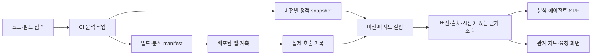

# 코드 관측성 구조 제안

이 문서는 코드 관측성에서 인프라·CMDB·SIEM까지 연결할 플랫폼의 책임 경계와 데이터 계약의 제안이다. **전체 영역이 구현 대상이며, 현재는 [요구사항·BDD](requirements/README.md)를 먼저 작성·토론하는 단계**다. 아래 코드 관측성 그림·흐름·저장 방식은 전체 설계를 논의할 일부 자료이며 승인된 아키텍처나 기술 채택은 없다. 대안과 판별 실험은 [DISCUSSIONS](DISCUSSIONS.md)에 있다.

## 질문과 근거 계약부터

첫 질문으로 “배포 이후 왜 느려졌는가?”를 제안한다. 조회는 느린 trace·실행된 메서드·일치하는 빌드·소스와 비교 조건을 반환하고, 근거가 부족하면 부족한 내용을 설명해야 한다. 관측 사실만으로 확정할 수 없는 원인은 가설로 구분한다.

| 근거 정보 | 조회 소비자가 판단할 내용 |
| --- | --- |
| evidence identity·원본 참조·출처 | 어느 수집기·분석·원본에서 나온 사실인가 |
| 코드·빌드·분석 버전 | 현재 조사하는 실행과 일치하는가 |
| 관측 시간 범위·수집 시점·조회 기준 시점 | 어떤 시점의 상태를 설명하는가 |
| freshness·수집 지연 | 얼마 전까지 반영됐고 갱신이 지연됐는가 |
| coverage·sampling·범위 제외 | 어느 범위에서 수집했으며 무엇이 빠졌는가 |
| 관계 유형·불확실성·불일치 | 실제 관측·정적 후보·가설 중 무엇인가 |

정확한 스키마와 신선도 계산은 미결이다. 읽기 전용의 범위 제한·페이지 처리·응답 상한·권한을 포함한 기계 조회 계약을 검토한다. 원본 덤프를 에이전트에 모두 전달하거나 근거 없는 신뢰 점수로 대체하는 방식을 기본으로 삼지 않는다.

## 두 경로와 결합

CI는 코드 구조를 분석하고 빌드에 대응하는 snapshot을 만든다. 실행 중 계측은 실제 호출을 관측한다. CI 작업이 운영 요청을 지속 수집하는 구조로 설명하지 않는다.

정적 관계는 호출 가능한 후보이며 런타임 기록은 관측한 실행의 증거다. 특정 요청의 호출 트리와 여러 요청을 합친 관계 그래프도 별도 보기·집계 규칙을 갖는다.

## 버전과 식별 계약

| 식별 정보 | 목적 |
| --- | --- |
| repository identity·revision | 분석한 저장소와 실제 커밋 식별 |
| build identity·artifact digest | 같은 커밋의 다른 의존성·빌드 산출물 구분 |
| module·class·method·JVM descriptor | 모듈과 overload를 구분하는 메서드 식별 후보 |
| analysis run·index digest | 특정 분석 실행과 생성한 정적 snapshot 식별 |
| analyzer·schema·config version | 도구·형식·진입점·classpath·포함 범위를 재현 |
| service·environment·deployment identity | 실행 앱·배포·빌드와 인프라 관계 연결 |

각 필드의 정규화·해시 대상·필수 여부·호환 규칙은 첫 데이터 계약 ADR에서 정한다. 소스 커밋만으로 바이트코드나 분석 결과가 같다고 가정하지 않는다.

런타임은 배포 artifact에 대응하는 manifest를 읽는 방식을 우선 검증한다. 분석 index를 함께 패키징할지 별도 보관할지는 비용과 배포 흐름을 비교한다. artifact 전체 해시를 해당 artifact 내부에 다시 넣는 순환 구조는 만들지 않는다.

PR 분석은 실제로 빌드한 revision을 기록한다. 브랜치 이름, PR head, 합성 merge revision을 같은 값으로 취급하지 않는다. dirty·로컬·출처 미확인 빌드는 상태를 명시한다.

## snapshot 자동 유지

첫 비교 기준으로 코드 변경 후 **전체 snapshot 재생성**을 제안한다. 증분 갱신·이벤트 파이프라인과 정확도·지연·비용을 비교해 선택한다. 메서드 추가·삭제·이름 변경, 실패·재시도·중복 실행과 freshness를 검증한다.

snapshot은 식별자별로 보존한다. 실행·배포가 참조하는 과거 버전은 최신 결과로 덮어쓰지 않는다. 증분 분석은 전체 재생성과 결과를 비교할 수 있고 비용 절감 근거가 있을 때 도입한다.

기존 snapshot이 없거나 스키마·빌드가 맞지 않으면 `missing`·`unsupported`·`mismatch` 등 구별 가능한 상태로 설명한다. 최신 브랜치의 지도로 대체 결합하지 않는다. 삭제·보존 기간과 배포 참조의 처리도 계약에 포함한다.

## 분석·계측 범위

- 정적 분석은 입력·classpath·진입점·알고리즘의 영향을 받으므로 설정과 미해결 관계를 남긴다.
- 런타임은 명시한 앱 패키지와 메서드 범위를 대상으로 한다. JDK·외부 라이브러리 전체 계측을 기본 약속으로 두지 않는다.
- private/self-call, 인터페이스 구현체, 프록시, reflection, lambda·재귀·비동기는 같은 fixture로 지원·누락을 확인한다.
- 기본 프레임워크 계측과 앱 메서드 계측을 구분하고 중복 span·SDK 소유권·context 전파를 검증한다.
- 미관측은 미실행·샘플링·범위 제외·수집 실패일 수 있다. 증거 없이 하나의 원인으로 단정하지 않는다.

실제 호출 기록에는 메서드·실행 부모/링크·시간·오류 유형 등 필요한 메타데이터를 제안한다. 인수·반환 본문·개인정보·예외 메시지·토큰은 공개 예제와 기본 수집 계약에서 제외한다. 메서드 식별자를 무제한 메트릭 라벨로 옮기지 않는다.

## 검증 구성과 통합 책임 후보

| 구성·영역 | 검증할 최소 책임 |
| --- | --- |
| 로컬 PoC | 분석 CLI, 버전별 snapshot, 제한된 실행 기록, 구조화된 읽기 조회와 작은 확인 화면 |
| 공유 실험 | snapshot 보관·조회 API, 권한, 보존 정책, 필요한 trace 저장·전송 경로 |
| MSA·Kubernetes | 서비스·배포·워크로드 식별 및 분산 context, 인프라 관계 수집 |
| CMDB·SIEM | 자산·보안 공급원별 adapter, 출처·유효 기간·권한을 보존하는 관계 |

위 표는 전체 구현 영역에서 확인할 책임이며 일부를 미래 선택 기능으로 분류하지 않는다. 플랫폼 설치 환경과 관측 대상 환경의 지원 표를 별도로 작성한다. 언어·런타임별 메서드 식별은 공통 근거 계약과 언어별 상세 정보로 나누는 안을 검토하며, JVM descriptor를 모든 언어의 필수 식별 형식으로 확정하지 않는다. CI·클라우드·수집 도구를 교체할 때 보존할 의미와 지원 차이는 [D06](DISCUSSIONS.md#d06-이식성의-책임과-지원-범위를-어떻게-나눌-것인가)에서 토론한다.

현재 Neo4j·Kafka·Kubernetes나 특정 클라우드가 필수라는 결정은 없다. 실제 노드·엣지 수, 조회 패턴, 이벤트량, 보존 기간과 운영 비용을 측정한 뒤 선택한다. 기존 관측 백엔드를 재사용하는 선택지도 비교한다.

## 첫 통합 검증

작은 통합 실험으로 같은 Java fixture의 두 빌드와 하나의 느린 요청을 제안한다. 정적 snapshot과 실제 실행을 생성하고, 에이전트의 읽기 조회가 올바른 trace·메서드·빌드·소스를 근거와 함께 반환하는지 확인한다. 이전 배포와 새 배포가 섞이지 않아야 한다.

판별 항목 후보는 overload·private/self-call·인터페이스·비동기·예상 오류, index 누락·불일치, 오래된 근거·부분 수집, 조회 상한과 업무 동작 보존이다. 조회 계약·구성 대안·합격 기준을 함께 토론한 뒤 실제 실험 범위를 정한다. 아직 실험을 실행하거나 설계를 채택하지 않았다.
