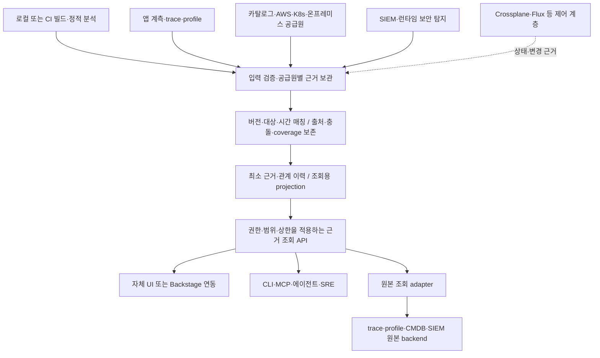

# OSS 아키텍처 비교와 JJAM-TONG의 차별화 가설

조사일: 2026-11-12. 상태: **공식 문서 조사 완료 · 구조 제안 · 제품 미채택 · PoC 미실행**.

후속 [자동 갱신 비교 실험](experiments/ARCHITECTURE-EXPERIMENTS.md)은 합성 공급원과 SQLite로 세 갱신 전략을 구현·실행했다. 이 문서에서 비교한 OSS 제품을 설치·계측한 PoC와 구분하며, 실제 제품·환경 비교는 후속 검증이다.

목표는 에이전트와 SRE가 코드·실행·배포·인프라·CMDB·보안의 근거를 같은 대상과 시점으로 조회하는 플랫폼이다. Backstage를 포함한 기존 제품과 경쟁하되, 기능 목록보다 **사고 당시의 관계를 얼마나 정확하고 적은 수작업으로 재구성하는가**로 판단한다. 모든 영역은 구현 대상이며 아래 실험 순서는 범위 축소가 아니다.

## 1. 비교의 결론과 확인 수준

우선 검증할 안은 **교체 가능한 도구 + JJAM-TONG이 소유하는 버전·시간·권한의 근거 계약**이다. 카탈로그·수집·분석 엔진을 재사용하고, 각 도구의 관계 주장을 출처와 함께 보존하는 결합·이력·조회 부분을 직접 책임지는 구성을 제안한다. 아직 승인된 ADR은 아니다.

이 문서의 `확인`은 링크한 공식 문서의 구조 설명을 확인했다는 뜻이다. `제안`은 그 구조를 우리 요구에 적용한 설계 판단이며, `미검증`은 실행·성능·실제 지원 조합을 확인하지 않았다는 뜻이다. 릴리스와 라이선스 원문은 [조사 스냅샷](OSS-SOURCE-SNAPSHOT.md)에 별도로 고정했다. 움직이는 `latest` 문서의 설명을 해당 릴리스에서 재현했다고 주장하지 않는다.

Backstage는 카탈로그·플러그인·권한 확장 기반이고, OpenChoreo는 관측 API·MCP를 포함하는 플랫폼이다. “카탈로그에 AI를 붙였다”만으로 우위를 주장할 수 없다. 문서에 없는 기능은 **미확인**으로 남기며 플러그인으로 구현 불가능하다고 판단하지 않는다. [Backstage backend](https://backstage.io/docs/backend-system/), [OpenChoreo 구조](https://openchoreo.dev/docs/overview/architecture/).

## 2. 영역별 구조 비교

제품 전체를 같은 종류의 대체재로 취급하지 않는다. 정적 분석기, 프로파일러, 카탈로그, 자원 제어기, SIEM은 서로 다른 책임을 맡는다.

| 후보·책임 | 확인한 구성과 데이터 흐름 | 가져올 구조 제안 | 그대로 맡길 수 있다고 확인하지 못한 요구·운영 부담 |
| --- | --- | --- | --- |
| **Backstage** · 카탈로그·개발자 포털 | entity provider → ingestion → processor → stitching → catalog API; backend plugin·module·service 확장 | 공급원 식별, 수집과 처리·관계 조립 분리, 논리 서비스·소유자 모델 | 사고 당시 메서드·빌드·관계 이력의 공통 계약은 별도 검증. 포털 앱·DB·플러그인 업그레이드 및 권한 정책을 운영 |
| **OpenChoreo** · IDP | experience·control·data·workflow·observability plane; Observer API·MCP와 교체 가능한 관측 adapter | 경험 계층과 실제 기능 API 분리, 수집·조회·제어의 수명주기와 보안 경계 | 문서의 data plane은 Kubernetes 기반. ECS·VM에 그대로 적용된다고 볼 수 없고, 전체 메서드 정적 그래프·빌드 결합은 미확인. 여러 plane·인증·연결을 운영 |
| **OpenTelemetry Collector·Java agent** · 계측·전송 | 앱 계측·context → receiver → processor → exporter → 외부 backend; agent/gateway 배치 | 표준 전송, 언어별 계측 adapter, backend 교체, 큐·재시도·수집 상태 관측 | Collector 자체는 분석용 장기 저장소가 아니다. Java 기본 계측을 모든 private/self-call의 실행 기록으로 볼 수 없다. 확장 API·중복 계측·분산 context·유실 경계를 검증 |
| **Apache SkyWalking** · 통합 APM | probe → platform backend/OAP → storage → UI | 계측부터 분석·조회까지 연결한 통합 기준선, 서비스·endpoint 관계와 저장소 경계 | 서비스 토폴로지를 전체 정적 메서드 그래프로 대체할 수 없다. 정확한 build/source 매칭과 agent·backend·storage 호환 조합, 통합 운영 비용은 미검증 |
| **SootUp** · JVM 정적 분석 | classpath·입력·진입점 → type hierarchy → CHA/RTA 호출 그래프 | 분석 실행을 버전별 재현 가능한 산출물로 취급, 알고리즘·입력 범위 보존 | 실행 사실·SIEM·CMDB를 제공하는 제품은 아니다. reflection·DI·프록시·입력 누락의 한계와 JVM별 호환성·LGPL 조건 검증 필요 |
| **Grafana Pyroscope** · 연속 프로파일링 | profiler → 수집·저장 → query; v2는 쓰기·조회 경로를 분리하고 object storage 활용 | trace/span과 profile 표본의 연결, 읽기·쓰기 확장 경계 | 표본은 모든 메서드 호출의 순서·횟수를 보증하지 않는다. span 표시가 있어도 표본이 없을 수 있다. v1/v2 구조를 혼합하지 않고 AGPL·SDK별 조건·저장 비용 검토 |
| **Cartography** · 자산·보안 관계 그래프 | intel module이 외부 API 수집 → 변환·Neo4j 적재 → 범위별 cleanup·분석 | 공급원별 connector, 안정적 ID, sync run과 범위가 있는 재조정 | 현재 상태의 cleanup을 과거 관계 삭제로 옮기면 안 된다. 사고 시점 이력·부분 수집·권한 계약은 별도 검증. Neo4j·원본 API 제한·자격증명 운영 |
| **NetBox** · 온프레미스 자산·네트워크 기준 정보 | 사이트·장비·인터페이스·IP·VM 등의 구조화된 모델과 API·plugin·변경 기록 | 자산 ID·소유권·세부 모델·검토된 선언 상태와 실제 관측의 분리 | 공식 철학은 원하는 상태의 source of truth. 실시간 발견·APM·SIEM·범용 시간 그래프를 대신한다고 보지 않는다. PostgreSQL·Redis·앱 및 plugin 호환 운영 |
| **Crossplane** · 자원 제어 | composite API·composition·provider/controller가 원하는 상태와 외부 자원을 지속 reconcile | 원하는 상태·관측 상태·처리 결과를 구분하는 계약, 공급원 adapter 경계 | 전체 인벤토리·CMDB 이력 수집기와 다르다. `Observe`는 beta·provider별 지원이고 알려진 자원 import가 모든 자원 자동 발견을 뜻하지 않는다. Kubernetes·provider·권한 운영 |
| **Flux** · GitOps 배포 제어 | source·kustomize·helm·notification controller가 artifact를 가져와 적용·상태 보고 | 시도한 revision과 성공한 revision 분리, 실제 배포 증거 연결 | 적용된 설정 revision은 앱 source commit이나 실제 실행 이미지의 증명과 다르다. ECS·VM 공통 실행 계약을 Flux CRD에 종속시키지 않는다. controller·RBAC·source 인증 운영 |
| **Wazuh** · SIEM/XDR | endpoint agent/agentless 입력 → server decoder·rule 분석 → indexer → dashboard/API | 원본 이벤트와 탐지 결과 분리, 규칙·공급원·시간·자산 근거 유지 | 연관 이벤트가 지연의 원인이라는 증명은 아니다. 이벤트 권한·보존·탐지 규칙 버전·재처리·자동 대응을 구분한다. agent·server·indexer·dashboard와 구성요소별 라이선스 운영 |
| **Falco** · 런타임 보안 탐지 | kernel driver 또는 plugin event → field extraction·rule engine → output | 수집 capability·event schema·탐지 규칙 버전, 수집 유실의 관측 | 완성된 SIEM 저장·사례 관리 제품은 아니다. kernel/syscall 관측을 Java 메서드 호출로 간주하지 않는다. 호스트 권한·커널·driver·plugin 조합별 가시성 확인 |

공식 구조 근거:

- 카탈로그·IDP: [Backstage entity 수명주기](https://backstage.io/docs/features/software-catalog/life-of-an-entity/), [backend 확장](https://backstage.io/docs/backend-system/), [권한 체계](https://backstage.io/docs/permissions/overview/), [OpenChoreo architecture](https://openchoreo.dev/docs/overview/architecture/), [platform abstractions](https://openchoreo.dev/docs/concepts/platform-abstractions/).
- 계측·분석: [Collector architecture](https://opentelemetry.io/docs/collector/architecture/), [복구·유실 조건](https://opentelemetry.io/docs/collector/resiliency/), [Java agent 확장](https://opentelemetry.io/docs/zero-code/java/agent/extensions/), [SkyWalking 구조](https://skywalking.apache.org/docs/main/latest/en/concepts-and-designs/overview/), [SootUp call graph](https://soot-oss.github.io/SootUp/latest/callgraphs/), [Pyroscope v2](https://grafana.com/docs/pyroscope/latest/reference-pyroscope-v2-architecture/about-pyroscope-v2-architecture/), [span profile](https://grafana.com/docs/pyroscope/latest/configure-client/trace-span-profiles/).
- 자산·제어: [Cartography sync](https://docs.cartography.dev/references/sync.html), [module·cleanup](https://docs.cartography.dev/dev/writing-intel-modules.html), [NetBox 모델·철학](https://netboxlabs.com/docs/netbox/introduction/), [설치](https://netboxlabs.com/docs/netbox/installation/), [Crossplane composition](https://docs.crossplane.io/latest/composition/compositions/), [기존 자원 import](https://docs.crossplane.io/latest/guides/import-existing-resources/), [Flux components](https://fluxcd.io/flux/components/), [배포 revision 상태](https://fluxcd.io/flux/components/kustomize/kustomizations/).
- 보안: [Wazuh architecture](https://documentation.wazuh.com/current/getting-started/architecture.html), [구성요소](https://documentation.wazuh.com/current/getting-started/components/index.html), [Falco kernel 경계](https://falco.org/docs/concepts/event-sources/kernel/architecture/), [plugin 구조](https://falco.org/docs/concepts/plugins/architecture/).

**AppMap Java는 별도 참고 사례**다. 메서드 호출 기록·코드 탐색은 가까운 비교 대상이지만, 확인한 v1.30.2는 MIT에 Commons Clause가 더해져 있다. 이 문서의 일반 OSS 재사용 후보와 분리하며 코드 복사·배포·상용 적합성을 승인하지 않는다. [Java agent 설명](https://appmap.io/docs/reference/appmap-java), [해당 버전 원문](https://github.com/getappmap/appmap-java/blob/v1.30.2/LICENSE.txt).

이 표는 1차 조사다. WALA·Byte Buddy는 [기존 코드 후보 조사](RESEARCH.md)에 유지한다. Argo CD·Cilium/Hubble·Prometheus/Tempo/Loki·OpenSearch 등은 이후 비교 확장 후보이며 이번 표의 조사 완료 대상으로 집계하지 않는다. 상용 서비스와 공개 소스 제품도 라이선스·배포판을 구분해 별도 조사할 수 있다.

## 3. 구조를 가져올 때 바꿔야 하는 의미

### 현재 상태의 수명주기와 사고 당시의 이력

Backstage는 공급원의 명시적 제거에 따른 entity 삭제와 processing·stitching의 관계 조립을 설명한다. Cartography는 sync tag와 범위별 cleanup을 설명한다. 공급원 소유권·재시도·재조정 구조는 참고하되, 이를 사고 근거의 물리 삭제 규칙으로 그대로 옮기지 않는 안이다.

JJAM-TONG의 제안은 **원본 주장 → 출처별 정규화된 근거 → 정책으로 만든 조회용 관계**다. 공급원별 주장을 보존하고 한쪽 주장이 바뀌어도 다른 출처의 사실을 덮어쓰지 않는다. 현재 화면의 관계와 보존 중인 과거 근거의 수명을 구분한다. 원본 보존·만료·삭제 정책은 별도 결정한다. [Backstage lifecycle](https://backstage.io/docs/features/software-catalog/life-of-an-entity/), [Cartography cleanup](https://docs.cartography.dev/dev/writing-intel-modules.html).

### 원하는 상태·관측한 상태·추정한 관계

NetBox의 검토된 기준 정보, Crossplane의 desired/observed state, Flux의 attempted/applied revision을 같은 사실로 합치지 않는다. 선언한 의존성, 정적 호출 후보, 실제 trace, 보안 규칙의 탐지는 각각 다른 종류의 근거다. 하나의 일반 `depends_on`만으로 의미를 지우는 모델을 피하는 안이다.

실행 이미지 digest와 빌드 manifest가 없으면 배포 설정의 Git revision만으로 메서드 snapshot을 선택하지 않는다. 알려진 자원의 Crossplane import가 성공해도 모든 AWS·온프레미스 자원의 발견·정합성이 검증된 것으로 집계하지 않는다. [NetBox 철학](https://netboxlabs.com/docs/netbox/introduction/), [Crossplane import](https://docs.crossplane.io/latest/guides/import-existing-resources/), [Flux revision](https://fluxcd.io/flux/components/kustomize/kustomizations/).

### 표준 수집과 완전한 실행 기록

OTel은 계측·전송·확장의 후보이며 모든 메서드의 완전 기록을 자동 제공하는 계약은 아니다. Pyroscope의 span profile도 샘플 기반 근거다. 메서드 실행 기록, trace, profile의 identity·sampling·coverage를 별도로 유지하는 안이다.

Collector의 큐·재시도·지속 저장을 사용해도 큐 포화·재시도 만료·디스크 실패 등의 유실 가능성이 남는다. 수집 실패를 업무 실패로 전파하지 않고, 유실 범위와 모르는 범위를 API에서 설명하는 요구를 실험한다. 정확히 한 번 전송이나 무손실을 전제로 하지 않는다. [Collector resilience](https://opentelemetry.io/docs/collector/resiliency/), [span profile의 한계](https://grafana.com/docs/pyroscope/latest/configure-client/trace-span-profiles/).

## 4. JJAM-TONG이 직접 책임질 가치

| 직접 소유할 계약·기능 제안 | 기존 제품 재사용으로 줄일 책임 | 판단 근거 |
| --- | --- | --- |
| 빌드·분석·배포·실행의 정확한 결합 | 정적 분석 엔진, bytecode 계측, trace 저장 | 같은 이름·커밋이라도 다른 build·artifact·분석 설정을 구분해야 함 |
| 코드·배포·자산·보안의 관계 이력과 출처 | 카탈로그·클라우드 inventory·CMDB·보안 원본 | 공급원마다 다른 ID·시점·권한·수명주기를 같은 분석 질문에서 설명해야 함 |
| 자동 갱신의 결과·실패·충돌·수집 범위 | CI 실행기·기존 controller·이벤트 공급원 | 오래된 성공을 새 성공으로 오표시하거나 수집 중단을 삭제로 오판하면 안 됨 |
| 권한을 보존하는 근거 조회와 설명 | 각 backend의 원본 API·인증 기반 | UI·CLI·MCP가 같은 허용 범위의 근거를 소비해야 함 |
| 도입·교체·제거 계약과 기능 지원 표 | 언어·환경·backend connector | Kubernetes 전용 모델을 ECS·VM에 강제하거나 도구 교체 때 이력을 잃으면 안 됨 |

위 표는 제품·DB·언어를 정한 결정이 아니다. 최소 계약에서 필요한 확장 필드를 보존하고 공급원 고유 기능을 무리하게 가장 작은 공통분모로 축소하지 않는다.

## 5. 비교할 세 가지 조립 방식

| 대안 | 이득 | 핵심 부담·반례 | 판별할 실험 |
| --- | --- | --- | --- |
| A. Backstage/OpenChoreo 등을 제품 기반으로 확장 | 카탈로그·인증·포털·확장 생태계 활용 | plugin·Kubernetes 모델 종속, 구현한 근거 서비스의 경계와 UI 결합 정도 | UI 없이 동일 근거를 조회하고 ECS·VM connector를 붙일 때 변경 범위 확인 |
| B. JJAM-TONG에 모든 원본을 중앙 적재 | 단일 조회·과거 재현·자체 권한 처리 | trace·profile·SIEM의 복제·보존·업그레이드·저장 비용과 원본 권한 변경 반영 | 같은 입력량의 적재·보존 비용, 원본 삭제·권한 회수와 재처리 확인 |
| C. 관계·필수 근거만 보관하고 큰 원본은 adapter로 조회 | 기존 backend 재사용, 자체 계약·UI 독립성 | 원본 만료·장애·권한·시점 차이; 원본 참조만 남으면 사고 재현 실패 | 반복 조회와 원본 중단·만료 시 재현 가능한 근거/없는 근거를 명시하는지 확인 |

**C를 우선 검증할 안으로 제안**한다. 과거 재현에 필요한 최소 근거를 무엇으로 정할지 먼저 확인해야 한다. A의 포털 연동과 C의 근거 backend를 함께 쓰는 것도 가능하다. 제품 호스팅·관측 대상·저장소 선정은 각각 별도 결정이며, 이 표는 MSA로 배포할 컴포넌트 개수를 정하지 않는다.

그림은 논리 책임이다. 별도 서비스·브로커·그래프 DB·Kubernetes 설치를 필수화하지 않는다. 관측·조회 권한과 자원 변경·보안 대응 권한을 분리하고 읽기 API가 변경을 실행하는 경로가 되지 않도록 제안한다. SIEM 탐지·분석·대응 기능의 범위와 승인은 별도 요구사항으로 계속 다룬다.

### 자동 갱신의 계약 후보

1. CI·수집기 입력에 공급원, 범위, run ID, 실제 입력 revision·artifact와 schema/config 버전을 붙인다. GitHub Actions는 한 adapter이며 공통 실행 계약 자체가 아니다.
2. 수집·분석 결과를 검증한 뒤 해당 버전·범위의 성공 결과를 공개한다. 중복·역순 입력과 동시에 끝난 두 빌드를 구분하고, 실패한 run으로 마지막 성공의 freshness를 갱신하지 않는다.
3. 이벤트는 빠른 갱신을 돕고 주기적 전체 재조정은 누락을 찾는 후보로 비교한다. 전체 snapshot을 기준선으로 증분 결과의 의미가 같은지 검증한다.
4. 삭제 이벤트 또는 완전하다고 확인한 수집 범위의 부재 근거를 정책으로 평가한다. 권한 거절·페이지 수집 실패·연결 중단은 삭제 근거로 쓰지 않는다. 유효 종료 시점이 불명확하면 추정 시각을 사실로 만들지 않는다.
5. 원본 근거와 버전·관계 revision으로 조회 결과를 재구성한다. 보존·만료·권한 회수로 재현할 수 없는 부분을 명시한다.

### 최소 근거 항목 후보

| 구분 | 필요한 의미 |
| --- | --- |
| 대상 | tenant/접근 범위, 논리 service, environment, deployment, 공급원별 resource ID; 식별자 동일성의 근거 |
| 코드·실행 | repo·commit·build·artifact digest, 언어별 method identity, analysis run·snapshot/index digest·analyzer/config/schema, trace/span·실행 관계 |
| 주장 | 관계 종류와 방향, declared/static-candidate/observed/detected 등의 근거 종류, 후보·확정·충돌 및 결정 정책 revision |
| 시간 | 원본 event/관측 시각, 수집 시각, 알려진 유효 구간, 플랫폼에 기록된 시각, 조회 기준 시점; 모르는 값과 시계 오차 |
| 갱신·한계 | 공급원·run·완료한 수집 범위·freshness·sampling·미해결·유실/누락 설명·원본 참조 |
| 접근·보존 | 원본·관계·필드의 권한과 재검증 방식, 마스킹·보존·만료 상태; 제한된 대상 존재 여부의 공개 정책 |

카탈로그 revision·매핑 revision·분석 schema·코드 build는 독립적으로 바뀐다. 하나의 `version`으로 대체하지 않는다. 관측 시각만 있는 자료에 실제 상태의 시작·종료 시각을 만들어 넣지 않는다. 외부 ID·메서드 ID를 정규화할 구체 형식은 미결이다.

## 6. 이식성에서 바로 확인할 제약

| 관측 대상 | 검증할 연결 | 피할 가정 |
| --- | --- | --- |
| AWS EKS / 일반 Kubernetes | 등록된 cluster identity + object UID + 당시 deployment·image·build; EKS의 AWS 자원 연결은 별도 근거 | 이름 재사용을 같은 객체로 병합, 일반 Kubernetes에 ARN 필수화 |
| ECS EC2 | cluster·service·task ARN·task definition·실제 image/build와 유효 시간; host 접근 capability | task definition revision을 코드 버전으로 치환, 모든 ECS를 Fargate와 같은 호스트 가시성으로 취급 |
| ECS Fargate | task·container·image/build, 앱 내부 계측·허용된 sidecar·외부 API 등의 실제 지원 수준 | EC2 호스트 접근·privileged/eBPF 수집을 그대로 사용 가능하다고 가정; 일부 capability로 모든 보안 수집이 같다고 판단 |
| 온프레미스 VM·물리 자원 | inventory/CMDB의 안정적 ID·원본·검토 상태와 관측 사실 연결 | IP·hostname만으로 동일성 확정, VM에 Pod 관계 요구 |

AWS 문서는 Fargate의 privileged·호스트 접근 제약과 `SYS_PTRACE` 허용을 구분한다. 이것만으로 특정 profiler·Falco 버전의 지원을 확정하지 않는다. [AWS Fargate 제약](https://docs.aws.amazon.com/AmazonECS/latest/developerguide/fargate-security-considerations.html), [capability API](https://docs.aws.amazon.com/AmazonECS/latest/APIReference/API_KernelCapabilities.html), [Kubernetes 이름·UID](https://kubernetes.io/docs/concepts/overview/working-with-objects/names/).

플랫폼을 어디에 설치하는가는 이 표와 별개다. 지원 표에는 실행 환경·OS/CPU·런타임·권한·계측/connector 버전, 지원/부분 지원/미지원·미확인을 기록한다. 조사상 가능성과 실행 지원 완료를 구분한다.

## 7. Backstage를 넘는다는 목표를 검증 가능한 질문으로 바꾸기

동일한 **커뮤니티 게시판** 합성 fixture를 사용한다. `GET /posts`와 `POST /posts/{id}/comments`, Controller → Service → private helper → Repository, 비동기 moderation 작업과 공유 DB를 포함하는 안이다. 두 빌드 B1/B2가 함께 실행되고 B2에서 조회 지연이 늘어난 상황을 만든다. 지연·보안 이벤트는 합성 자료다.

| 질문·반례 | 기대 결과 | 연결한 기존 BDD·태스크 |
| --- | --- | --- |
| Q1. B2 배포 뒤 느려진 요청에서 실제 실행 메서드와 정적 후보는 무엇인가? | 해당 trace·메서드·B2 snapshot·source 근거와 미관측/미해결을 구분. 정적 후보를 실행 사실로 표시하지 않음 | BDD-REL-001~004, BDD-VER-001~003, BDD-SRE-001~004; [#5](https://github.com/DDINGJOO/JJAM-TONG/issues/5), [#8](https://github.com/DDINGJOO/JJAM-TONG/issues/8), [#19](https://github.com/DDINGJOO/JJAM-TONG/issues/19) |
| Q2. 메서드 삭제·이름 변경, 이벤트 누락·역순·중복, B1/B2 동시 분석은? | 각 build 결과를 보존하고 실패·오래됨을 설명. 과거 실행을 최신 HEAD에 연결한 결과 0건을 판정 조건 후보로 사용 | BDD-UPD-001~004; [#12](https://github.com/DDINGJOO/JJAM-TONG/issues/12) |
| Q3. EKS·ECS·온프레미스의 같은 서비스와 공유 DB는? | 논리 서비스·배포·실물 자원 분리, 확인된 동일성·시점으로 다대다 매핑. 이름·태그만 같은 자원은 후보/충돌 | BDD-INF-001~006, BDD-CAT-001~005; [#22](https://github.com/DDINGJOO/JJAM-TONG/issues/22), [#32](https://github.com/DDINGJOO/JJAM-TONG/issues/32) |
| Q4. 담당자가 바뀌고 inventory 원본은 중단됐으며 보안 이벤트가 늦게 도착하면? | 사건 시점의 담당·관계와 늦게 알게 된 근거를 구분. 모르는 시점을 만들거나 수집 중단을 삭제로 해석하지 않음 | BDD-CMDB-001~003, BDD-CAT-002/005, BDD-SEC-001~003; [#26](https://github.com/DDINGJOO/JJAM-TONG/issues/26), [#29](https://github.com/DDINGJOO/JJAM-TONG/issues/29) |
| Q5. 카탈로그만 허용된 에이전트가 보안·자산 관계를 물으면? | 허용한 근거만 반환. 제한된 ID·이름·관계·원본 내용의 유출 0건을 판정 조건 후보로 사용. 권한 정책이 허용하는 누락 설명 제공 | BDD-AGT-001~004, BDD-CAT-006, BDD-SEC-002; [#15](https://github.com/DDINGJOO/JJAM-TONG/issues/15) |
| Q6. Collector/backend를 중단·교체하고 계측을 제거하면? | 업무 결과·예외·비동기 동작 보존, 수집 범위·유실·원본 만료를 설명, export/import에서 의미·권한 보존 | BDD-REL-004, BDD-UPD-004, BDD-AGT-004, BDD-SRE-004; [#19](https://github.com/DDINGJOO/JJAM-TONG/issues/19) |

BDD는 [기존 37개 Draft 명세](requirements/README.md)에 대응시킨 것이다. 위 표는 각 Scenario의 문장을 승인하거나 실행 테스트가 통과했다는 뜻이 아니다. 시간 이력·중복/역순 등 더 세밀한 fixture의 기대 결과는 담당 태스크에서 검토한다. 독립적인 기대 관계 집합을 만들고 지원 범위의 정상 입력에서 정확한 결합·조회도 성공해야 한다. 모든 결과를 미확인·접근 거절로 반환해 오연결·유출 0건만 맞추는 구현은 통과시키지 않는다.

비교 기준선은 **A: 버전·플러그인·연동 backend를 명시한 Backstage 구성**, **B: 지원 환경을 명시한 OpenChoreo 구성**, **C: JJAM-TONG의 같은 질문을 처리하는 최소 구현**이다. 빈 Backstage 설치와 모든 backend를 붙인 JJAM-TONG을 비교해 우위를 주장하지 않는다. 비교 제품의 미지원 환경과 미확인 기능을 구분하고 필요한 custom 구현량도 기록한다.

측정할 값은 오연결·권한 유출·출처 누락 건수, 갱신 지연, 질의 응답 시간, 조사 완료 시간·수작업 단계, 에이전트가 추가로 읽은 자료량, 앱 CPU/메모리·지연 변화, 일일 적재량·보존 비용, 설치·업그레이드·connector 변경량이다. 동일 입력·자원·수집률·보존 조건을 기록한다. 성능 수치·허용 예산·우위는 아직 측정하거나 합의하지 않았다.

## 8. 판별 실험과 결정 순서

| 실험 제안 | 입력·주요 비교 | 남길 산출물·판정 | 담당 기존 태스크 |
| --- | --- | --- | --- |
| P1 코드·실행 결합 | 게시판 B1/B2, SootUp와 기존 정적 후보, OTel 확장/별도 계측 대안; 통합 APM의 같은 질문 | 재현 절차·정답 fixture·오연결/미해결·앱 영향·호환 조합. 범위 밖 수집과 원래 동작 변경도 검사 | #5, #8, #19 |
| P2 자동 관계 유지 | 코드 변경, 전체 재생성 대 증분, 중복·역순·실패·이벤트 누락 | version별 결과·run 상태·원본 근거·차이. 잘못된 최신 성공·과거 덮어쓰기 여부 | #12, #32 |
| P3 이력·자산·보안 결합 | catalog/inventory·CMDB·SIEM 합성 입력, 공유 자원·담당자 변경·수집 지연·권한 거절 | 당시 관계·이후 확인한 근거·충돌·권한 제한을 가진 API 응답. 범위별 삭제·보존·재처리 정책 대안 | #15, #22, #26, #29, #32 |
| P4 조립 방식·운영 비용 | A/B/C 구조에 같은 질의·원본 중단·만료·교체 조건 | 재현성·지연·복제량·설치/운영 항목과 변경량. 라이선스·의존성·CVE·업그레이드 검토 | #19 및 각 영역 검증 태스크 |

표는 후속 실험 계획이며 이번 작업에서 설치·라이브 클라우드 접근·계측·성능 측정은 하지 않았다. 제품 버전·테스트 입력·예산을 토론한 뒤 실행 범위를 정한다. 각 실험의 결과로 재사용/직접 구현 경계와 ADR을 결정한다. 문서 조사나 릴리스가 최신이라는 이유만으로 제품을 채택하지 않는다.

현재 논의할 선택은 **근거 backend를 JJAM-TONG의 중심으로 두고 Backstage 등을 연동 표면으로 활용할지**, **과거 재현을 위해 어디까지 근거를 자체 보존할지**, **첫 게시판 fixture에서 어느 계측 대안을 비교할지**다. 전체 범위·지원 목표를 유지하며 [D01~D08 설계 토론](DISCUSSIONS.md)에서 결정한다.
