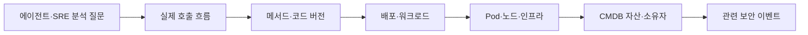

# JJAM-TONG Platform 비전

에이전트와 SRE가 서비스의 동작과 변경을 빠르고 정확하게 분석할 수 있도록, 코드·실행·인프라·자산·보안에 걸친 신뢰할 수 있는 근거 기반을 만든다.

제품의 중심은 **가시성을 자동으로 유지하고, 그 근거로 분석과 운영을 자동화하는 것**이다. 연결한 공급원에서 서비스와 관계를 발견하고 변경을 따라가며, 사람이 반복해서 지도를 수정하는 부담을 줄인다. GitHub를 첫 자동 온보딩 경로로 구체화하고 발견·등록·갱신·실패 복구의 행동은 [자동화 제품 기획](requirements/AUTOMATION.md)에서 검토한다.

## 풀려는 문제

코드 구조, 실제 요청, 배포 버전, 인프라 자산과 보안 이벤트가 서로 다른 화면과 식별자로 관리된다. 관계 지도를 수동으로 만들면 갱신이 늦고, 에이전트가 매번 데이터를 모으면 출처·시점·수집 범위를 잃거나 최신 소스와 이전 배포의 실행을 잘못 연결하기 쉽다.

**코드 변경에 맞춰 메서드 관계를 자동 갱신하고, 그 버전의 실행 근거를 서비스·워크로드·자산·보안과 연결해 기계가 조회하게 만든다.** 코드 관측성·에이전트 근거 조회·SRE·MSA·Kubernetes·인프라·CMDB·SIEM은 모두 구현 대상이다. 영역별 구현 순서는 의존성과 설계 토론으로 정한다.

## 분석 질문과 근거

에이전트와 SRE는 “배포 이후 왜 느려졌는가?”, “어떤 코드·서비스·자산까지 영향을 확인할 수 있는가?”, “이 결과는 현재 배포와 일치하고 얼마나 최신인가?”를 묻는다. 다음은 이를 지원할 관계의 제안이다.

예를 들어 배포 전후의 비교 근거와 느린 trace, 실행된 메서드, 일치하는 빌드와 소스를 함께 반환하는 조회를 검토한다. 비교 조건이 다르거나 수집이 부족하면 그 한계를 함께 반환한다. 시간적 연관성을 인과관계로 확정하지 않는다.

근거에는 식별자·버전·출처·수집 시점·대상 시간 범위·신선도·수집 범위·불확실성이 필요하다. 관측 사실, 정적 후보, 분석 가설을 구분하고 후속 원본 확인이 가능해야 한다. 그래프와 대시보드는 이 조회 결과를 사람이 이해하는 채널이다.

## 구현 영역과 검증 근거

| 영역 | 범위 | 확인할 근거 |
| --- | --- | --- |
| 코드 관측성 | 메서드의 정적 후보·실제 실행·자동 갱신·버전별 근거 조회 | 다른 버전이 섞이지 않고 근거와 한계를 기계가 조회하는 최소 재현 |
| MSA·인프라 | AWS EKS·ECS와 일반 Kubernetes의 분산 context와 환경별 실행 식별 | 서비스·빌드·배포와 Pod 또는 task의 관계를 재배포 후에도 설명 |
| 카탈로그·CMDB | 논리 서비스·시스템·소유자와 온프레미스·AWS 자원 매핑 및 관계 이력 | 다중 환경·공유 자원·변경·삭제·충돌을 출처·유효 시간과 함께 검증 |
| 보안·SIEM | 자산과 보안 이벤트의 시간·식별자 기반 탐색 | 접근 권한·보존·출처를 유지한 연계 시나리오 검증 |

전체 영역의 구현이 프로젝트 목표이며, 현재 태스크는 **요구사항·BDD·토론·검증 계획**이다. 코드 관계·버전, 자동 갱신·에이전트 근거, SRE·인프라, CMDB·SIEM의 기대 결과와 경계를 함께 명세한다. 실제 에픽·스토리·태스크는 [ROADMAP](../ROADMAP.md)의 이슈가 기준이다. 각 영역의 기술·공급원·저장소 경계는 아직 결정하지 않았다.

## 공통 원칙

- 관계는 자동으로 수집·갱신하되, 수집 범위와 분석 한계를 드러낸다.
- 에이전트는 필요한 범위의 구조화된 근거를 읽고 원본·버전·시점까지 추적할 수 있어야 한다.
- 원본 코드 버전과 실행·배포 버전을 구분하고 과거 결과를 보존한다.
- 정적 후보 관계, 실제 관측 관계, 운영자가 확인한 자산 관계를 구분한다.
- 이름만으로 연결하지 않고 식별자·출처·시간 범위를 함께 사용한다.
- 카탈로그의 선언 관계와 실제 수집·실행 관계를 구분한다. 환경 이동에도 논리 서비스의 식별을 유지하고 당시 배포·자원 관계를 보존한다.
- 기존 오픈소스를 비교해 재사용할 부분과 직접 만들 부분을 정한다.
- 수집량·보존 기간·권한·운영 비용을 실제 사용 규모에서 검증한다.
- 플랫폼 설치 환경과 관측 대상 환경을 구분한다. 언어·CI·수집 도구의 교체에서 근거의 의미·버전·출처·권한을 보존하고 지원 차이를 설명한다.

## 직접 만들 가치가 있는 부분

우선 검증할 제품 가치는 **버전이 맞는 관계의 자동 유지와 에이전트·SRE가 신뢰할 수 있는 근거 조회**다. 관측 백엔드, 정적 분석 엔진, SIEM을 모두 새로 구현하는 결정은 하지 않았다. 도구를 조합해도 버전·출처·시점·권한·수집 범위를 설명하지 못하면 이 목표를 달성한 것으로 보지 않는다.

## 현재 약속의 경계

현재 저장소에는 운영용 수집기·분석기·통합 화면이 구현되어 있지 않다. 전체 구현 범위와 현재 지원 기능을 구분하며, 모든 언어·메서드·동적 호출을 완전하게 분석하거나 관측한다고 약속하지 않는다.

현재 요구사항은 [요구사항·BDD](requirements/README.md), 작업 범위와 완료 기준은 [PROJECT](PROJECT.md)에 있다. 요구사항 초안을 함께 토론한 뒤 [후보 조사](RESEARCH.md)와 PoC, [설계 토론](DISCUSSIONS.md), ADR을 거쳐 구현으로 진행한다. 현재 승인된 아키텍처나 스택은 없다.
