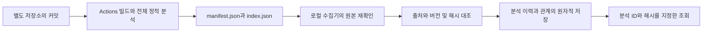

# ADR 0006 GitHub 분석 결과를 로컬로 가져오는 경계

날짜: 2026-11-13. 상태: **별도 Java 검증 모듈의 첫 GitHub 연동에 적용**.

연결: [T25 #44](https://github.com/DDINGJOO/JJAM-TONG/issues/44), [갱신 기본안](0001-reconciliation-baseline.md), [저장 계약](0005-local-versioned-evidence-store.md), [실행 명령](../../tools/github_evidence_sync/README.md), [검증 결과](../experiments/GITHUB-EVIDENCE-SYNC.md).

## 코드 변경과 저장을 연결한다

별도 [Playground](https://github.com/DDINGJOO/JJAM-TONG-playground)의 코드를 수정하면 GitHub Actions가 그 커밋을 빌드하고 정적 호출 후보를 분석한다. 결과는 GitHub의 보관 파일인 artifact로 발행한다. 로컬 수집기는 성공한 실행을 주기적으로 확인하고 검증한 색인만 기존 PostgreSQL 저장 계약에 전달한다. Actions에 로컬 DB 접속 권한을 주지 않는다.

첫 대상은 `method-fixture`의 Java 17 일반 JAR이다. 기존 JavaParser·WALA 분석기와 Python 표준 라이브러리, PostgreSQL 저장 어댑터를 재사용한다. Spring Boot 실행 JAR 내부의 클래스와 의존성을 해석하는 기능은 이 경로에 아직 연결하지 않는다.

## 실행과 버전을 함께 식별한다

분석 실행 ID는 GitHub의 저장소 숫자 ID·workflow 실행 ID·재실행 회차를 합쳐 만든다. 같은 커밋을 다시 빌드해도 실행 회차별 이력을 구분한다. 원본 색인에는 저장소·커밋·빌드·모듈·실제 JAR 해시와 분석기·스키마·설정 버전을 보존한다.

수집기는 명시한 저장소·브랜치·workflow의 성공한 `push` 또는 `workflow_dispatch` 실행만 허용한다. GitHub 실행 정보, artifact 정보, 다운로드한 ZIP의 SHA-256, manifest와 색인의 버전·해시를 대조한다. 다운로드 뒤에도 실행과 artifact 정보를 다시 확인한다. 어느 단계든 일치하지 않으면 새 분석을 발행하지 않는다.

ZIP에는 `manifest.json`과 `index.json` 두 파일만 허용한다. 애플리케이션 소스나 JAR을 artifact에 넣지 않는다. 다만 색인에는 클래스·메서드 이름과 관계가 있으므로, 실제 비공개 프로젝트에는 artifact 열람 권한과 보존 정책도 적용해야 한다. 해시 일치는 변경 탐지 수단이며 신뢰할 수 없는 workflow의 빌드 출처를 별도로 인증하지 않는다.

## 재시도와 과거 이력을 보존한다

매 확인 때 설정한 페이지 범위의 완료된 실행을 다시 찾는다. 최근 실행 하나만 선택하거나, 단순 실행 ID 체크포인트로 늦게 끝난 분석을 건너뛰지 않는다. 같은 분석·해시는 재시도로 처리하고 다른 내용으로 덮어쓰지 않는다. 조회자는 분석 ID와 색인 해시를 함께 지정하며, 수집하지 못한 버전을 최신 버전으로 대체하지 않는다.

첫 수집기는 이미 저장한 artifact도 다시 내려받아 검증한다. 단순한 복구 계약을 우선한 선택으로 호출량·다운로드 비용이 반복해서 발생한다. 페이지 범위 밖의 이력, artifact 만료·삭제로 생긴 공백을 자동 복원하지는 못한다. 장기 운영에는 신뢰할 수 있는 처리 원장과 보존·재수집 정책, 호출 제한에 따른 대기와 작업 예산이 필요하다.

## 대안과 적용 한계

| 대안 | 이번 범위에서의 판단 |
| --- | --- |
| Actions가 DB에 직접 저장 | 로컬 DB를 외부에 열고 접속 권한을 CI에 배포해야 하므로 첫 연결에는 사용하지 않음 |
| GitHub 알림으로만 수집 | 누락된 알림의 복구와 수집기 외부 노출이 필요함. ADR 0001의 원본 재확인 경로부터 구현 |
| artifact를 로컬 수집기가 가져옴 | DB는 로컬에 유지하고 중단 뒤 재시도 가능. 확인 지연과 GitHub 보관 기한을 수용 |
| CI에서 플랫폼 전체를 배포 | 분석 발행과 운영 배포의 권한·수명주기가 달라 이번 변경에 포함하지 않음 |

이 선택은 GitHub 전용 연동 도구에 적용한다. GitHub 식별자를 모든 CI·언어의 공통 계약으로 확정하지 않는다. 수집기는 단일 프로세스의 순차 실행이며, 로컬 프로세스와 DB가 살아 있을 때만 계속 갱신한다. 운영 서비스의 인증·인가, 상시 실행 관리, 장기 보존·대규모 수용량은 별도 검증 대상이다.

이번 경로는 정적 후보를 갱신한다. 실제 trace의 지속 수집, Boot 서비스 전체 분석, 화면 자동 갱신·배포는 연결하지 않았다. #44의 정확한 overload 실행 식별·부분 재분석·이벤트 문맥·수집 유실 조건도 계속 남는다.

API 동작은 GitHub 공식 [workflow 실행 조회](https://docs.github.com/en/rest/actions/workflow-runs#list-workflow-runs-for-a-workflow), [artifact 목록](https://docs.github.com/en/rest/actions/artifacts#list-workflow-run-artifacts), [다운로드](https://docs.github.com/en/rest/actions/artifacts#download-an-artifact), [artifact 해시 검증](https://docs.github.com/en/actions/tutorials/store-and-share-data#validating-artifacts)을 기준으로 구현하고 실제 GitHub 실행과 대조한다. GitHub Enterprise Server와의 동등한 동작은 전제하지 않는다.
