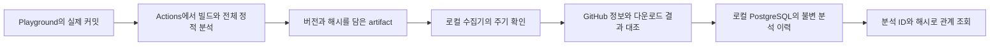

# 실제 Git 커밋 변경과 메서드 관계의 자동 수집 검증

2026-11-13에 별도 [Playground](https://github.com/DDINGJOO/JJAM-TONG-playground)의 실제 커밋 두 개를 GitHub Actions에서 분석하고, 로컬 PostgreSQL에서 버전별 관계를 조회했다. 첫 결과는 지정 수집으로 가져왔고, 두 번째 결과는 실행 중인 수집기의 주기 확인으로 자동 저장됐다. **메서드 이름 변경·추가·삭제가 새 분석에 반영됐고 이전 분석은 보존됐다.**

연결: [T25 #44](https://github.com/DDINGJOO/JJAM-TONG/issues/44), [ADR 0006](../decisions/0006-github-method-evidence-pull.md), [실행 명령](../../tools/github_evidence_sync/README.md), [구조화한 실제 결과](github-evidence-sync-results.json), [기존 저장 검증](VERSIONED-EVIDENCE-STORE.md).

## 분석과 저장을 나눈 구성

Actions는 로컬 DB에 접속하지 않는다. 로컬 수집기가 HTTPS로 GitHub의 결과를 가져온다. DB는 `127.0.0.1:29632`에만 연결한다. Python 3.9와 기존 Psycopg 3.2.12, PostgreSQL 17.11 저장 어댑터를 재사용했다. 수집·발행을 위한 새 패키지는 추가하지 않았다.

첫 분석 대상은 `method-fixture`의 일반 Java JAR이다. 빌드 JDK는 21이고 분석 대상 바이트코드는 Java 17 기준으로 만든다. 분석기는 JavaParser 3.28.2와 WALA 1.9.0이다. Actions에서 가져오는 플랫폼 코드는 [`d9f8e71`](https://github.com/DDINGJOO/JJAM-TONG/commit/d9f8e71f997f25500e7df5d952dc87b9ee6896c7)로 고정했다. 실행마다 실제 JAR·소스 해시를 확인하고 커밋·빌드·모듈·분석기·스키마·설정 정보를 색인에 넣었다.

## 실제 소스를 수정한 두 커밋

| 비교 이름 | 실제 Playground 커밋 | `RefreshPolicy`의 관계 | GitHub 실행 |
| --- | --- | --- | --- |
| A | [`9fcee03`](https://github.com/DDINGJOO/JJAM-TONG-playground/commit/9fcee03059866b9774abf33ebbb59f091d6bcd8d) | `validate → legacyCheck` | [43399888465](https://github.com/DDINGJOO/JJAM-TONG-playground/actions/runs/43399888465), 성공 |
| B | [`0ea6a68`](https://github.com/DDINGJOO/JJAM-TONG-playground/commit/0ea6a6845550a86114c28bcbf660723ac3575561) | `validateInput → hasKey` | [43401783284](https://github.com/DDINGJOO/JJAM-TONG-playground/actions/runs/43401783284), 성공 |

B에서는 `validate`를 `validateInput`으로 바꾸고 `legacyCheck`를 삭제했으며, boolean 값을 반환하는 private 메서드 `hasKey`를 추가했다. `Service`의 호출 대상도 새 메서드로 바꿨다. 변경 전후의 기대 관계는 소스에서 먼저 정했고, 각 분석기의 DB 조회 결과와 대조했다. A·B는 비교 이름이며, 같은 커밋에 소스 변형을 덧씌운 두 빌드를 뜻하지 않는다. 두 실행 모두 실제 커밋의 원본을 분석한다.

두 Actions 실행에서 라이브러리·대상 빌드, 분석기 정확성 검증, 메서드 분석과 MSA 통합 시나리오 9개가 각각 통과했다. B로 커밋할 소스의 로컬 사전 확인에서도 `method-fixture`의 기능 시나리오 10개를 통과했다. 최종 색인은 미커밋 소스의 사전 빌드가 아니라 깨끗한 CI 체크아웃에서 만들었다. 각 CI의 단계별 판정·9개 시나리오 결과와 커밋 전 사전 확인은 JSON 결과의 `ciValidation`·`localPreCommitSmoke`에 구분했다.

## 수집 결과와 과거 관계를 대조했다

분석 ID는 `gh-1456346630-실행ID-1`이다. `1456346630`은 Playground의 GitHub 저장소 숫자 ID이고 마지막 `1`은 실행 회차다. 이 식별자와 정확한 색인 해시를 함께 지정해 조회했다. 실제 JAR·색인·ZIP 해시와 artifact ID는 [JSON 결과](github-evidence-sync-results.json)에 보존했다.

| 확인 조건 | 실제 결과 |
| --- | --- |
| GitHub 정보와 다운로드 | 두 ZIP의 SHA-256이 GitHub의 digest와 일치. 내부 파일은 `manifest.json`·`index.json` 두 개 |
| A의 기대 관계 | JavaParser·WALA 모두 `Service.validate → RefreshPolicy.validate → legacyCheck` 조회 |
| B의 기대 관계 | JavaParser·WALA 모두 `Service.validate → RefreshPolicy.validateInput → hasKey` 조회 |
| 이전 분석 보존 | B 저장 후 A의 색인 해시·조회 결과·행 수가 최초 저장 때와 동일 |
| 삭제된 메서드 | B에서 `legacyCheck(String)`를 시작점으로 지정하면 두 분석기 모두 `UNRESOLVED`·`ROOT_NOT_IN_ANALYZER`. A로 대체하지 않음 |
| 잘못된 버전 조합 | A의 분석 ID와 B의 해시, B의 분석 ID와 A의 해시를 각각 `VersionMismatch`로 거부 |
| 같은 결과 재수집 | `replay` 반환. 분석별 원본 1행·메서드 58행·호출 54행 유지 |
| 주기 수집 | 30초 간격의 `watch`가 B를 처음 발행. B의 첫 저장에 수동 DB 가져오기 명령을 사용하지 않음 |

58개 메서드 행은 JavaParser의 27개와 WALA의 31개를 각각 저장한 합계이며 고유한 메서드가 58개라는 뜻은 아니다. 조회용 호출도 각각 25개와 29개를 합쳐 54행이다. `Service.list(String)`에서 깊이 4로 조회한 부분 그래프는 JavaParser가 메서드 6개·호출 5개, WALA가 메서드 8개·호출 7개였다. 두 버전에서 개수는 같았지만 바뀐 메서드와 관계는 서로 달랐다.

## 부분 분석과 실패를 보존했다

두 버전 모두 분석 결과 전체에 미해결 8개·제외 2개가 있어 조회 상태를 `PARTIAL`로 반환했다. JavaParser에는 목록에 없는 끝점으로 향하는 호출 근거도 3개 있다. 원본에 남기고 조회용 노드는 새로 만들지 않았다. 이 집계는 분석 전체의 공백이며, 이번 시작 메서드에서 해당 항목을 실제 실행했다는 뜻은 아니다.

수집 기능을 넣기 전의 오래된 성공 실행에는 메서드 artifact가 없었다. 수집기는 `UNAVAILABLE`을 기록하고 계속 확인했으며, 새 실행의 정상 결과는 저장했다. artifact가 없는 실행을 수집 완료로 표시하거나 최신 색인으로 대체하지 않았다.

오프라인 경계 검증에서는 PR·다른 브랜치·다른 저장소·실패한 실행, 커밋·회차·해시 변조, ZIP의 추가·중복 파일·경로 이동, 잘못된 JSON, 다운로드 뒤 artifact 변경과 재실행 시작을 주입했다. 거부 사례는 DB 발행 전에 차단했고, 정상 결과 재시도와 다른 실행의 수집은 유지했다. 실제 원격 재실행을 일으켜 경쟁시킨 결과와는 구분한다.

초기 연결 점검에서 workflow 조회에 전체 파일 경로를 쓰는 문제와 비공개 로컬 계약 파일 의존성을 수정했다. 전체 조회 창이 꽉 차면 새 결과까지 차단하던 오류도 회귀 시험으로 재현한 뒤 고쳤다. 현재는 설정한 최근 조회 창을 처리하며, 그 밖의 과거 실행은 수집을 보장하지 않는다. 발행·수집 도구 사이의 실제 형식 호환도 같은 시험에서 대조한다.

## 다음 검증 범위

이 경로는 `method-fixture`의 전체 정적 재분석이다. Spring Boot 실행 JAR 내부의 클래스·의존성 분석, 실제 trace의 지속 수집, 코드 변경의 영향 범위 계산과 부분 재분석, 화면 자동 갱신은 아직 연결하지 않았다. 기존 Playground의 MSA 기능 시험과 이 메서드 색인의 분석 범위를 구분한다.

수집기는 로컬 프로세스와 DB가 실행 중일 때만 동작하며 컴퓨터 재시작 뒤 자동 기동은 설정하지 않았다. 이미 저장한 artifact도 재확인하므로 반복 호출·다운로드 비용이 있다. 이벤트 종류별 기본 3페이지의 확인 범위와 분석 artifact의 7일 보관 기한 밖에 생긴 이력 공백은 자동 복원하지 못한다. 실제 GitHub 호출 제한·네트워크 장애의 장기 복구, 운영 권한·보존·대규모 수용량은 후속 검증 대상이다.

현재 DB의 조직 라벨은 조회 조건이며 인증·인가가 아니다. 해시 대조는 신뢰한 workflow가 낸 결과의 일치 확인이며 원격 빌드 출처 인증을 대신하지 않는다. #44의 정확한 overload 실행 식별, outbox SDK 문맥 연결, Redis 관측 공백과 실제 전송 유실 조건도 열린 상태로 유지한다.

## 후속 로컬 Boot 검증

이 CI 경로와 별도로 [실제 Boot 게시판의 메서드·요청 연결](BOOT-METHOD-EVIDENCE.md)을 로컬에서 검증했다. 기존 bundle v1의 대상·수집 계약은 바꾸지 않았으며, Boot 결과의 CI 발행과 trace 지속 수집은 다음 연결 범위다.
