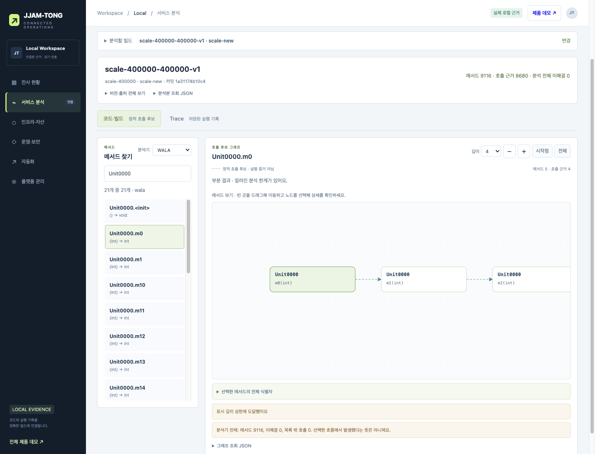

# 실제 Java 결과를 색인·DB·화면까지 연결한다

기존 10 MiB 출력 제한에서 실패했던 401,023줄 합성 Java 입력을 분석기 `0.2.3`으로 다시 실행했다. 분석 파일과 색인의 공백을 줄여 **기존 상한을 유지한 채 이전·새 빌드의 분석 → 색인 저장 → PostgreSQL 발행·재조회 → 브라우저 탐색을 통과했다.** 반복 생성한 합성 입력의 로컬 검증이며 기업 코드의 지원 규모를 뜻하지 않는다.

작업은 [#73](https://github.com/DDINGJOO/JJAM-TONG/issues/73), 상위는 [#68](https://github.com/DDINGJOO/JJAM-TONG/issues/68)이다. [형식 비교](JAVA-PUBLICATION-COMPARISON.md)와 [ADR 0011](../decisions/0011-java-compact-publication.md)에 선택 이유를, [실험실](../../experiments/java_publication_lab/README.md)에 재현 명령을 남겼다. 수치·버전·해시와 화면 판정은 [구조화한 결과](java-compact-integration-results.json)에 있다.

## 결과의 의미와 바이트를 구분한다

Java 생산자는 발행 전용 JSON 설정을 사용한다. 분석 결과를 정렬하는 기존 `Model.JSON` 설정은 보존하고 출처 버전만 `0.2.3`으로 올렸다. 메서드 색인과 CI 색인 포장도 공백을 줄인다. CI는 지속적 통합을 뜻하며, 여기서는 GitHub Actions의 검증 모듈 결과 포장을 가리킨다.

스키마는 기존 `jjamtong.methods.v1`이다. Java 파일은 끝 개행을 포함하고, Python 색인 파일과 CI의 `index.json`은 끝 개행 없이 저장한다. 두 표현 모두 기존 JSON 판독기로 읽는다. 파일 해시는 실제 저장 바이트에서 다시 계산한다. 논리 색인 해시는 정규화한 내용으로 계산하므로 들여쓰기에는 영향을 받지 않지만, 분석기 출처 버전이 바뀐 색인을 이전 분석과 같은 해시라고 취급하지 않는다.

생산자의 10 MiB 제한은 UTF-8 직렬화 중 적용한다. 제한 초과·인코딩·이동 실패에서는 이전 파일을 보존한다. 색인의 불변 저장과 CI의 출처·해시 검증도 유지한다. DB 입력 검증인 `prepare`는 기본 공백을 포함한 별도 10 MiB 예산을 그대로 사용한다. 따라서 작은 파일도 DB 경계에서 거부될 수 있다.

## 같은 입력의 전체 분석을 대조한다

이전 빌드와 새 빌드는 각각 Java 소스 435개, 실제 401,023줄이다. 새 빌드에서는 `Unit0000.m19(int)`를 `m19Updated(int)`로 바꾸고 호출부도 함께 변경했다. 저장소·커밋·빌드·모듈·원본 JAR·소스 목록의 해시를 확인하고 다른 입력과 결합한 색인은 거부했다. JAR는 컴파일한 Java 클래스의 배포 파일이다. 이 예제의 커밋 식별자는 합성 메타데이터이며 실제 앱 저장소의 커밋이 아니다.

기준 생산자는 `7748983c75f988fd94acdc6b70101581e51ed873`의 모든 Java 소스를 격리 복사해 실행했다. 발행 상한과 표시 버전만 `32 MiB`·`0.2.2-probe32`로 바꿨다. 현재 생산자의 클래스 파일은 사용하지 않는다. 재실행한 기준 파일의 SHA-256은 이전 비교 기록과 바이트 단위로 같았다.

현재 빌드가 기록한 전체 실행 의존성 명세와 실제 JAR 목록·바이트를 대조하고, 역사적 재실행에는 명시적 클래스 경로를 사용한다. 직접 의존성 6개는 기존 고정 해시도 확인한다. 전이 의존성을 포함한 16개 JAR의 전체 해시는 결과에 남겼다. 전이 의존성은 직접 선택한 도구가 다시 필요로 하는 라이브러리다. 빌드가 생성한 명세를 검증한 것이며, 과거의 모든 전이 버전을 고정한 잠금 파일이 있다고 주장하지 않는다.

현재 생산자의 JAR·소스 7개·의존성 명세·실행 JAR 전체를 실행 전후에 다시 확인했다. 기준 파일·비교 기록의 해시와 정확한 입력 식별자도 대조했다. **버전 표기 한 필드를 제외한 전체 JSON이 같았으며 메서드·관계·소스 위치도 같았다.** JDK가 다르면 바이트가 달라질 수 있으므로 동일성 판정은 같은 Corretto 21.0.11 실행 조건에 한정한다.

## 실제 크기와 로컬 처리 비용

아래는 최초 이전·새 빌드를 순서대로 실행한 각 1회 표본이다. Java는 1 GiB 최대 힙, PostgreSQL 17.11 컨테이너는 CPU 1개·메모리 1 GiB로 실행했다. 운영 처리량이나 형식별 성능 순위를 비교하는 수치가 아니다. 이후 무결성 재실행은 역사적 생산자 재실행과 병행했으며 별도 결과로 보존했다.

| 항목 | 이전 빌드 | 새 빌드 |
| --- | --- | --- |
| 분석 파일 | 7,647,610바이트 | 7,647,638바이트 |
| 저장한 색인 파일 | 8,433,388바이트 | 8,433,423바이트 |
| `prepare`의 별도 직렬화 | 9,207,836바이트 | 9,207,871바이트 |
| WALA 메서드·호출 후보 | 9,116개·8,680개 | 9,116개·8,680개 |
| JavaParser 메서드·선언 해석 호출 | 8,681개·8,680개 | 8,681개·8,680개 |
| 분석 경과 시간 | 29.935초 | 29.672초 |
| 분석 프로세스 최대 상주 메모리 | 1,364,836,352바이트 | 1,386,119,168바이트 |
| DB 최초 발행 | 1.359초 | 1.447초 |
| DB 전체 색인 재조회 | 0.160초 | 0.174초 |

상주 메모리는 운영체제가 관측한 프로세스 메모리다. JVM 힙 상한과 같지 않으며, 전체 파이프라인의 메모리 사용량을 계속 측정한 결과가 아니다. 색인 생성·저장·검증 시간과 재실행 값은 구조화한 결과에 보존했다.

DB에서 재조회한 전체 색인은 발행 전 내용과 같았다. 같은 ID·해시의 재시도는 새 분석을 만들지 않았다. 같은 분석 ID에 다른 내용, 다른 색인 해시, 이전 분석에 새 입력을 연결한 시도는 거부했다. 새 빌드를 저장한 후에도 이전 빌드의 전체 색인은 그대로 조회됐다.

이전 빌드의 논리 색인 해시는 `2b134819fde2e952e8e69f4f5b82d5e576ebbb47b1cfd013568097853931b6b3`, 새 빌드는 `2b12ab1360fb1034782fdfae79354d9b80c1d8073f48c9fda2d709f7d1a4de7b`다. 색인 파일의 바이트 해시는 이 논리 해시와 별도로 기록했다.

## 브라우저에서 실제 DB 근거를 확인한다

Orca 브라우저에서 조회 화면을 직접 조작했다. 아래 판정은 서버의 실제 DB 응답을 사용한다. Trace 결합 검사에는 별도로 만든 OTLP(OpenTelemetry 전송 형식) 기록 두 개를 사용했다. **이 기록은 QA용 합성 입력이며 실제 앱 요청이나 지속 수집의 증거가 아니다.**

| 시나리오 | 실제 판정 |
| --- | --- |
| 이전·새 빌드 선택과 검색 | 이전 빌드의 `m19`, 새 빌드의 `m19Updated`를 각각 표시했다 |
| 분석기 전환 | WALA 9,116개와 JavaParser 8,681개 목록을 구분했다 |
| 끝 메서드 선택 | 메서드 1개·호출 0개의 `STATIC_CANDIDATES`를 표시했다 |
| 전체 진입점과 제한된 깊이 | 노드 상한에서는 80개·79관계, 깊이 상한에서는 5개·4관계의 `PARTIAL`과 제한 사유를 표시했다 |
| 목록 더 보기 | 처음 80개에서 160개로 늘었고 전체 9,116개와 현재 표시 개수를 구분했다 |
| 빈 검색 결과 | 0개 안내와 빈 그래프를 표시했다 |
| 잘못된 색인 해시 요청 | 실제 서버가 거부했고 이전 메서드·그래프·Trace 내용을 비웠다. 올바른 분석본 재선택으로 복구했다 |
| 같은 빌드의 합성 Trace | 해당 빌드의 메서드 후보에만 연결하고 부모 누락을 `PARTIAL`로 남겼다 |
| 다른 빌드의 합성 Trace | 양방향 모두 `MISMATCH`로 거부하고 연결한 span은 0개였다 |
| 화면 크기와 확대 | 1440×1100·390×844에서 페이지 가로 넘침이 없었다. 전체 관계 보기와 시작점 확대를 조작했다 |

해시 오류 검사는 요청 한 번의 `index_sha256`만 바꿨다. 응답이나 화면 내용을 위조하지 않았으며 검사 후 정상 요청 함수를 복원했다. 콘솔 조회에는 기록이 없었다. 비동기 화면이 로딩 중일 때 너무 일찍 읽은 검사 호출은 다시 기다린 뒤 판정했으며 제품 오류로 계산하지 않았다.

전체 보기에서는 메서드 글자를 줄이거나 생략하므로 읽을 때 확대·시작점 이동이 필요하다. 관계 밀도가 높은 실제 기업 그래프의 자동 배치·묶음·가독성은 별도 검증 대상이다. [모바일 시작점 화면](java-compact-qa/mobile-graph.png)과 [합성 Trace 결합 화면](java-compact-qa/synthetic-trace.png)도 함께 보존했다.

## 회귀·독립 검토와 지원 경계

깨끗한 Maven 빌드와 JDK 17.0.19·21.0.11의 기존 오라클 네 종류를 실행했다. 오라클은 기대한 정답과 실제 결과를 대조하는 실행 검사다. 발행 오라클은 각 JDK에서 38개 검사를 통과했다. Python으로 생산자 포장·기존 들여쓰기 읽기·색인·수집기·DB 계약·공통 작업 계약·비교·기준 결과와 실행 의존성 반례를 검사한 100개 테스트와 실제 PostgreSQL·조회 서버 회귀 37개도 통과했다.

독립 코드 검토는 생산자 소스 일부 누락과 와일드카드 클래스 경로의 추가 JAR 문제를 지적했다. 소스 전체 확인, 전체 실행 의존성 명세 대조와 명시적 역사적 클래스 경로로 보완했다. 설계 검토의 기준 버전·기준 해시 고정과 실제 브라우저 판정 누락도 보완했다. 최종 재검토·국문 편집 결과는 작업 이슈와 PR에 기록한다.

이번에 401,023줄 합성 입력을 처리한 경로는 로컬 생산자·색인·DB·화면이다. GitHub 포장·수신은 기존 `method-fixture`의 정확한 출처 제한에서 새 공백 표현과 이전 표현을 회귀 검증했다. 이 대규모 입력을 Actions에서 발행하거나 `scale-400000`을 CI 허용 모듈에 추가한 것은 아니다.

분석 중 전체 Map과 소비자의 전체 색인 보관은 그대로다. 더 큰 결과·큰 단일 메타데이터 레코드, 임의 소스 구조, 지속 수용량·기업 권한·고가용성·분산 작업 소유권·운영체제 자원 강제는 앞으로 검증한다. [#65](https://github.com/DDINGJOO/JJAM-TONG/issues/65)의 범용 모듈·의존성 발견과 [#66](https://github.com/DDINGJOO/JJAM-TONG/issues/66)의 서비스·이벤트 경계도 이번 반복 생성 입력의 성공으로 대체하지 않는다.
