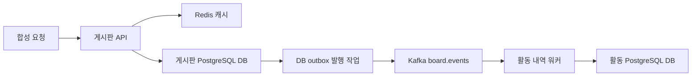

# 별도 MSA 관측 대상과 로컬 검증

연결: [T25 #44](https://github.com/DDINGJOO/JJAM-TONG/issues/44), [라이브러리](../../libraries/evidence-contract-java/README.md), [빌드 식별 결정](../decisions/0002-experimental-build-identity.md), [분석·계측 비교 조건](CODE-ANALYSIS-COMPARISON.md).

사용자가 기존 프로젝트를 지정하는 대신 Kafka·Redis·RDS를 사용하는 실제와 비슷한 MSA 대상을 만들어 달라고 요청했다. 관측 대상은 **별도 로컬 Git 저장소**에 만들었다. JJAM-TONG에는 재사용할 라이브러리와 검증 근거만 둔다. 대상 저장소의 원격 공개는 아직 수행하지 않았다.

## 구성과 요청 흐름



게시판 API는 글 생성·조회·수정·삭제와 Redis 캐시를 담당한다. 글을 바꾸는 DB 트랜잭션 안에서 발행 대기 이벤트도 저장한다. 이 발행 대기 테이블을 **outbox**라 부른다. 별도 발행 작업이 Kafka의 저장 확인을 받은 뒤 발행 완료로 표시한다. 브로커 장애 중에도 글과 이벤트는 DB에 남고, 복구 후 다시 발행한다.

활동 워커는 Kafka 이벤트를 받아 별도 DB에 활동 내역을 저장한다. 같은 이벤트가 다시 올 수 있으므로 이벤트 ID의 중복 확인과 활동 기록을 같은 DB 트랜잭션으로 처리한다. 이 범위에서 중복 효과를 막으며, Kafka와 DB를 포괄하는 정확히 한 번 실행을 보장한다고 표현하지 않는다. outbox 발행 작업은 한 인스턴스만 실행한다. 여러 Pod의 발행 경쟁·순서 보장은 후속 검증 대상이다.

소비자 오류 처리는 실패한 이벤트를 건너뛰지 않도록 명시했다. 실패 뒤 1초의 대기 시간을 두고 재시도하며, 메시지 처리 완료를 기록한 위치(offset)를 자동 복구 처리로 앞당기지 않는다. 계속 처리할 수 없는 레코드는 소비 진행을 막을 수 있다. 별도 실패 큐로 옮기는 정책은 아직 정하지 않았다. 관련 동작은 [Spring Kafka 오류 처리 문서](https://docs.spring.io/spring-kafka/reference/kafka/annotation-error-handling.html)와 [사용한 버전의 처리기 원문](https://github.com/spring-projects/spring-kafka/blob/v4.1.2/spring-kafka/src/main/java/org/springframework/kafka/listener/DefaultErrorHandler.java)을 기준으로 확인했다.

로컬 PostgreSQL 서버 하나에 게시판·활동 DB를 나눴다. 두 서비스는 서로의 테이블을 읽지 않는다. DB 주소와 자격증명은 환경 변수로 받으므로 RDS 연결을 준비할 수 있다. **실제 RDS의 IAM 인증·TLS·관리형 장애 전환이나 AWS 네트워크는 검증하지 않았다.**

Redis 장애 때 조회는 DB로 대체하고, Kafka 장애 때 쓰기는 outbox에 남긴다. 따라서 API의 준비 상태(readiness)는 선택 의존성인 Redis·Kafka 때문에 실패하지 않게 구성했다. 시작 시 의존 서비스가 준비되기를 기다리는 Compose 조건과, 실행 중 API가 요청을 받을 수 있는지 나타내는 readiness는 구분한다.

## 버전과 실행 형태

| 항목 | 선택한 로컬 조건 |
| --- | --- |
| 대상 앱 | Spring Boot 4.1.2, 두 서비스와 공통 내부 모듈. 실제 빌드 JDK는 Temurin 21.0.7+6, 실행 JDK는 Temurin 21.0.13+9 |
| 빌드 | `maven:3.9.9-eclipse-temurin-21`; 호스트 Maven 설치 없음 |
| 이벤트 | `apache/kafka:4.3.2`; 단일 브로커, 로컬 복제 계수 1 |
| 캐시 | `redis:8.10.3-alpine`; 캐시 내용의 영구 보존을 전제하지 않음 |
| DB | `postgres:17.11-alpine`; 서비스별 DB, 로컬 서버 공유 |
| 실행 | 격리한 Compose 프로젝트 `jjamtong-sandbox`; 앱 포트만 loopback에 공개 |

대상 프로젝트의 프레임워크·클라이언트 선택은 사용자가 위임한 합성 대상 제작 범위다. 플랫폼의 정적 분석기·OTel·Byte Buddy 도입 결정으로 확대하지 않는다. 선택 근거는 [Spring Boot BOM 원문](https://repo.maven.apache.org/maven2/org/springframework/boot/spring-boot-dependencies/4.1.2/spring-boot-dependencies-4.1.2.pom), [Kafka Docker 문서](https://kafka.apache.org/43/getting-started/docker/), [PostgreSQL 공식 이미지](https://hub.docker.com/_/postgres), [Redis 공식 이미지](https://hub.docker.com/_/redis)다. Redis 8은 [RSALv2·SSPLv1·AGPLv3 다중 라이선스](https://redis.io/legal/licenses/)이며 BSD 라이선스로 기록하지 않는다. 전체 전이 의존성의 보안·재배포 검토는 이번 실행 검증과 별개다.

## 라이브러리 소비와 두 빌드

플랫폼에서 만든 JAR을 대상 프로젝트의 로컬 Maven 캐시에 설치한다. 각 서비스의 최종 JAR을 만든 뒤 실제 SHA-256과 저장소·revision·빌드·모듈을 외부 메타데이터 파일(sidecar manifest)에 기록한다. 시작할 때 라이브러리로 실제 앱 JAR의 해시를 다시 계산해 sidecar와 다르면 거부한다.

`/evidence/build`는 이 식별 정보와 산출물 해시 확인 여부를 노출한다. 아직 대응하는 분석 결과는 없으므로 `analysisLinkStatus`는 `UNRESOLVED`다. `automaticMethodAnalysis`와 `runtimeMethodTracing`도 `false`다. 두 빌드는 JAR manifest에 서로 다른 빌드 ID를 넣어 같은 소스 revision에서도 구분한다. 이것은 메서드별 실제 요청 흐름을 수집한 결과가 아니다.

다음 명령은 별도 대상 저장소가 있는 로컬 검증자를 위한 것이다. `JJAM_REPO`, `JJAM_TARGET_REPO`, `JJAM_JDK_HOME`은 각자 경로로 지정한다. 공개한 플랫폼 소스만으로 별도 대상 앱까지 내려받을 수 있는 상태는 아니다.

```sh
python3 "$JJAM_REPO/libraries/evidence-contract-java/build.py" --java-home "$JJAM_JDK_HOME"
cd "$JJAM_TARGET_REPO"
python3 scripts/build.py --library "$JJAM_REPO/libraries/evidence-contract-java/build/evidence-contract.jar"
python3 scripts/verify.py
docker compose --project-name jjamtong-sandbox ps
```

앱은 `127.0.0.1:28180`과 `127.0.0.1:28181`에서 실행한다. 장애 검증은 이 Compose 프로젝트의 Redis·Kafka를 중지했다가 복구하며 볼륨은 삭제하지 않는다. 합성 장애 제어 경로는 로컬 테스트 설정에서만 활성화한다.

## 실행 결과와 남은 범위

소스 revision `acb83684c4b8c318b7c0ca77edbb5948af0952ac`의 깨끗한 작업 트리에서 두 빌드를 만들었다. [원시 결과와 도구·산출물 기록](local-msa-target-results.json)에 실제 실행 이미지·네 JAR의 해시·소요 시간을 남겼다. 2026-11-12 UTC 실행에서 **통합 시나리오 9개와 Kafka CLI 출력 해석 코드의 경계 예제 3개가 통과**했다. 공통 모듈 테스트 3개도 두 빌드에서 각각 통과했다.

| 시나리오 | 확인한 결과 |
| --- | --- |
| 글 생성·조회·비동기 활동 | 같은 글을 조회하고 캐시 HIT와 활동 1건 확인 |
| Redis 중지 | DB 대체 조회와 API readiness 유지 |
| Kafka 중지·복구 | 미발행 outbox 보존, 복구 뒤 활동 반영 |
| 같은 이벤트 재전송 | 처리 위치가 따라잡은 뒤에도 활동 1건 유지 |
| 활동 DB 연결 차단·복구 | 실제 처리 실패 12회 동안 처리 위치 유지, DB 복구 뒤 활동 1건 반영 |
| DB 조회 지연 | 실제 SQL 지연 뒤에도 동일 응답 유지 |
| 두 INSERT 이후 DB 오류 | 글과 outbox 모두 롤백, 다음 쓰기 성공 |
| 수정·삭제 | 조회·캐시·활동 내역의 변경 확인 |
| 두 서비스 × 두 빌드 | 서로 다른 최종 산출물 해시와 실행 중 JAR/sidecar 일치 확인 |

활동 DB 장애 시나리오의 44.764초는 차단·검사·복구를 포함한 전체 소요 시간이다. 차단 시간만 따로 측정하지 않았으며, 수집 오버헤드나 운영 성능 측정으로 해석하지 않는다. Kafka CLI에서 아직 커밋하지 않은 위치를 `-`로 표시할 때는 0으로 추정하지 않고 미확인으로 보존했다. 원본 로그가 비어 있는 경우와 처리할 메시지가 남은 경우를 별도 경계 예제로 검사했다.

독립 확인에서도 두 앱의 준비 상태·버전 응답, 네 산출물의 실제 해시, 새 글의 생성·조회·활동 1건 반영을 대조했다. 장애 검사 전후 다른 프로젝트의 컨테이너는 유지됐고, 이 대상의 DB 연결과 Redis·Kafka도 복구했다.

현재 앱은 Kubernetes로 옮길 수 있도록 컨테이너·환경 변수·준비 상태·자원 한도를 갖춘 로컬 대상이다. Kubernetes·EKS·ECS에 배포한 결과는 없다. Redis/DB 사이의 원자적 일관성, 다중 발행자, 운영 부하·고가용성도 검증하지 않았다. 다음 단계는 앱 기능 추가보다 **정적 호출 후보와 실제 메서드 실행을 연결할 도구 선택 및 C01~C12 실행**이다. #44와 기존 47개 Draft BDD의 전체 완료로 집계하지 않는다.

추가 비교는 [실행 모델과 이벤트 경계 검증](CODE-ANALYSIS-COMPARISON.md#실행-모델과-이벤트-경계도-함께-검증한다)에 정리했다. 현재 HTTP 구성은 MVC/Tomcat이고 Redis 클라이언트는 Netty 기반 Lettuce다. 가상 스레드·WebFlux/Netty·추적 문맥 전파의 비교는 아직 실행하지 않았다.
