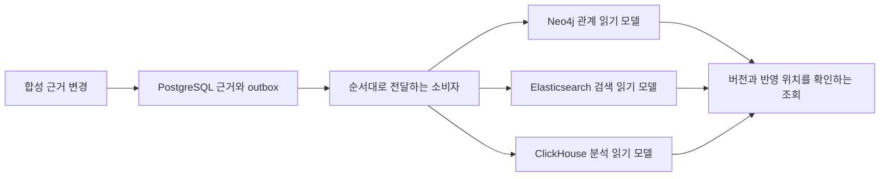

# 버전 근거·그래프·검색·집계의 DB 비교

날짜: 2026-11-13. 상태: **로컬 비교 구현·실행 / 제품 DB 선택은 보류**.

사용자는 DB 선택을 먼저 검토하고, Elasticsearch·Neo4j 등 여러 후보를 실제로 구현해 비교하자고 요청했다. 파이프라인마다 다른 DB를 쓰는 구성도 비교 대상이다. 이 문서는 [관계 저장 비교 축](ARCHITECTURE-EXPERIMENTS.md)을 실행한 결과다. [T24 #43](https://github.com/DDINGJOO/JJAM-TONG/issues/43)의 중앙 보관·연합 조회·최소 보관 비교와는 다른 실험이며, 그 태스크를 완료했다고 해석하지 않는다. [T25 #44](https://github.com/DDINGJOO/JJAM-TONG/issues/44)의 라이브러리 적용·정확한 메서드 식별 과제도 계속 남아 있다.

구현: [storage_lab](../../experiments/storage_lab/README.md). 원시 표본과 이미지 digest: [실행 JSON](storage-engine-run.json). 기존 업무 MSA나 관측 수집 서버의 DB는 변경하지 않았다.

## 지금 얻은 결론

**데이터의 책임에 따라 DB를 조합할 수 있다. 조합의 조건은 원본의 보존 책임, 버전 일치, 반영 지연과 재구축 가능성을 설명하는 것이다.** 특정 DB 하나를 플랫폼 전체에 강제하거나 네 종류를 모두 운영하기로 결정하지 않았다.

이번 작은 입력에서는 PostgreSQL도 관계 조회·검색·집계를 모두 처리했다. 따라서 전용 그래프 DB나 검색 DB를 추가해야 하는 규모의 경계는 아직 정하지 않는다. Neo4j의 관계 표현, Elasticsearch의 검색 기능, ClickHouse의 대량 집계가 유리할 것으로 예상하는 조건은 더 큰 입력과 운영 비용으로 검증해야 한다. 아래 지연은 **현재 어댑터·스키마·드라이버를 포함한 로컬 조회 경과 시간**이며 엔진 자체의 성능 순위가 아니다.

## 저장할 내용의 책임부터 구분한다

조회에 빠른 복제본을 만들더라도 원본과 같은 보존 책임을 부여할지는 별도 결정이다. 여기서 조회용 복제본을 **읽기 모델**이라고 부른다. 삭제되거나 손상됐을 때 보존한 원본으로 다시 만들 수 있는지 확인해야 한다.

| 데이터 | 후보 역할 | 설계에서 확인할 질문 |
| --- | --- | --- |
| 조직·정책·서비스 등록·분석 작업·버전 목록 | 관계형 DB의 원장 | 원자적 변경·현재 권한·동시 갱신·감사를 어떻게 보장하는가? |
| 정적 메서드·호출 후보·서비스·배포·자산 관계 | 관계형 관계 테이블 또는 그래프 읽기 모델 | 정확한 빌드·분석 설정으로 다중 단계 탐색·역방향 영향 조회를 할 수 있는가? |
| 로그·보안 이벤트 | 검색·분석 저장소 | 전문 검색·필터·집계·보존과 삭제의 비용은 얼마인가? |
| 대량 span·시간별 통계 | 열 지향 분석 저장소 또는 기존 추적 backend | 처리량·압축·시간 범위 집계·trace 상세 조회를 함께 만족하는가? |
| 지표·프로파일 | 기존 전용 backend 또는 별도 비교 후보 | Prometheus·Tempo·Pyroscope 등 기존 수집·저장 체계를 어디까지 재사용하는가? |
| 분석 원문·원시 이벤트·장기 이력 | 객체 저장소와 목록 DB의 조합 후보 | 다시 분석·재색인할 자료를 어떤 비용과 보존 정책으로 확보하는가? |
| 반복 조회의 캐시 | 캐시 저장소 후보 | 권한 회수·버전 변경·삭제 시 언제 무효화되는가? |

이는 책임을 나누는 설계 제안이다. **모든 로그·span을 PostgreSQL outbox에 통과시키겠다는 제품 설계는 아니다.** 대량 관측 데이터는 수집 경로·내구성 있는 전달·일괄 저장과 원시 자료 보존을 별도로 비교해야 한다. 이번 outbox 구현은 적은 양의 근거 변경을 정확히 전달하는 비교용 구성이다.

## 후보별로 우리에게 맞는 부분

| 후보 | 우리 구현에서의 후보 역할 | 실제 확인 또는 앞으로 비교할 조건 | 이번 실행 |
| --- | --- | --- | --- |
| PostgreSQL | 버전·정책·카탈로그 원장, 초기 관계 조회 | 재귀 SQL·전문 검색으로 출발할 수 있다. 관계 수·분기·이력·권한 조건이 커졌을 때 비용을 확인한다. | 실행 |
| Neo4j | 메서드·인프라·자산의 다중 단계 관계 탐색 | 경로 질의로 표현할 수 있다. Enterprise 기능·운영 계약·라이선스와 읽기 모델의 재생 비용을 함께 비교한다. | Community 실행 |
| Elasticsearch | 로그·보안 사건의 전문 검색과 집계 | 쓰기 성공과 검색 노출은 별도다. 색인 세대·mapping·순서 충돌·재색인·보존 정책을 확인한다. | 실행 |
| ClickHouse | 대량 로그·span·분석 통계 | 일괄 적재와 열 지향 집계 후보다. 변경·삭제·중복 처리의 의미와 읽기 비용을 확인한다. | 실행 |
| OpenSearch | 검색·보안 분석의 다른 배포·라이선스 후보 | Apache 2.0 배포와 기능 구성을 확인한다. 현재 ES 9 질의·mapping의 호환성을 가정하지 않는다. | 공식 자료 조사 |
| Apache AGE | PostgreSQL 안에서 그래프 질의 추가 | 별도 그래프 서버를 줄일 수 있는 후보다. PostgreSQL 버전·확장 설치 권한·Cypher 호환·업그레이드를 확인한다. | 공식 자료 조사 |
| JanusGraph | 분산 그래프 저장 후보 | storage와 index backend의 조합을 관리한다. 분산 규모의 이점과 여러 구성 요소의 장애·운영 부담을 함께 비교한다. | 공식 자료 조사 |
| Amazon Neptune | AWS 설치의 관리형 그래프 후보 | Gremlin·openCypher·SPARQL을 제공한다. 플랫폼의 온프레미스 설치 요구와 AWS 전용 연동을 분리한다. | 공식 자료 조사 |
| MongoDB | 문서 중심 근거와 제한된 재귀 조회 후보 | `$graphLookup`의 깊이·메모리·분할 조건과 관계 변경의 비용을 확인한다. | 공식 자료 조사 |

후보 역할은 공식 기능을 바탕으로 한 설계 판단이며 해당 제품의 우위를 입증한 결과가 아니다. PostgreSQL [재귀 질의](https://www.postgresql.org/docs/17/queries-with.html), Neo4j [가변 길이 경로](https://neo4j.com/docs/cypher-manual/5/patterns/variable-length-paths/), Elasticsearch [검색 노출과 refresh](https://www.elastic.co/docs/manage-data/data-store/near-real-time-search), ClickHouse [관측성 저장 설계](https://clickhouse.com/docs/guides/use-cases/observability/build-your-own/introduction)를 확인했다.

추가 후보의 근거는 [OpenSearch 저장소](https://github.com/opensearch-project/OpenSearch), [Apache AGE 구조](https://age.apache.org/overview/), [JanusGraph 구조](https://docs.janusgraph.org/master/getting-started/architecture/), [Neptune 소개](https://docs.aws.amazon.com/neptune/latest/userguide/intro.html), [MongoDB graphLookup](https://www.mongodb.com/docs/manual/reference/operator/aggregation/graphlookup/)다. 추가 후보는 서버를 설치하거나 성능을 측정하지 않았다.

## 비교한 구성과 실제 버전

| 구성 요소 | 고정 이미지·드라이버 | CPU 상한 | 메모리 상한 | 라이선스 조사 |
| --- | --- | --- | --- | --- |
| PostgreSQL | `postgres:17.11-alpine` | 1 CPU | 384 MiB | PostgreSQL License |
| Neo4j | `neo4j:5.26.33-community` | 1 CPU | 1,024 MiB | Community GPLv3; Enterprise 별도 |
| Elasticsearch | `elasticsearch:9.5.6` 공식 이미지 | 1 CPU | 1,536 MiB | 기본 배포 ELv2와 소스의 라이선스 선택을 구분 |
| ClickHouse | `clickhouse/clickhouse-server:26.8.36.3` | 1 CPU | 1,024 MiB | Apache 2.0 |
| PostgreSQL 드라이버 | Psycopg binary 3.2.12 | 호스트 실행 | 별도 측정 안 함 | 서버와 별도 의존성으로 관리 |

각 서버의 이미지 digest는 실행 JSON에 고정했다. PostgreSQL은 기존 로컬 이미지 버전을 재사용했으며 최신 패치 선택 결과가 아니다. 나머지도 이 실험의 고정 버전으로 기록한다. 운영 도입 전에는 지원 기간·보안 패치·배포 형태를 다시 판단한다.

라이선스 원문: [PostgreSQL](https://www.postgresql.org/about/licence/), [Neo4j](https://neo4j.com/open-source-project/), [Elastic 배포와 소스 구분](https://www.elastic.co/pricing/faq/licensing), [ClickHouse](https://github.com/ClickHouse/ClickHouse/blob/master/LICENSE). 이 목록은 해당 버전·제품의 초기 검토이며 JJAM-TONG의 재배포·서비스 제공 방식에 대한 적합성 판정을 완료한 것은 아니다.

## 공통 데이터와 예상 결과

두 tenant `alpha`·`beta`, 같은 commit의 `build-A`·`build-B`, 서로 다른 artifact 해시를 사용했다. 분석 식별자에는 분석기·설정·스키마 버전을 담고, 일부 메서드만 포함하는 다른 분석 설정도 별도로 넣었다. repository·module·build·artifact·analysis를 각 근거에 남긴다. commit과 해시는 합성 식별자이며 실제 Git/JAR에서 추출한 값이 아니다.

repository와 module은 각각 하나이며, build ID가 artifact를 고유하게 가리키는 입력이다. 여러 저장소·모듈에서 같은 build 이름을 재사용하거나 같은 build 이름에 다른 artifact를 넣는 입력 검증까지 시험한 것은 아니다. 실제 입력의 식별 계약은 기존 [버전 근거 라이브러리](../../libraries/evidence-contract-java/README.md)와 연결해 확장한다.

| 입력 | 작은 규모 | 큰 규모 |
| --- | --- | --- |
| tenant·build 조합 | 4 | 4 |
| 조합별 일반 메서드 노드 | 150 | 1,500 |
| dispatcher의 직접 분기 | 6 | 60 |
| 합성 로그 총수 | 1,000 | 20,000 |
| 전체 근거 수 | 2,491 | 34,307 |

메서드 호출에는 순환 관계를 넣었다. 별도 dispatcher 노드로 분기 수가 늘어나는 경우를 비교했다. 인프라에는 서비스→배포→Pod→Subnet→VPC와 RDS·S3를 연결했다. 정적 후보와 실제 실행 span은 다른 종류의 근거로 저장했다.

입력 해시는 네 DB에서 같다. 기대값은 DB 질의를 실행하기 전에 Python의 집합·계수 연산과 고정 예제로 정한다. SQL·Cypher·검색 응답을 복사해 정답으로 쓰지 않는다. 발생·인지 시각은 합성 정수이며 실제 시계나 네트워크 지연을 나타내지 않는다.

각 입력에서 다음을 확인했다.

- 정적 호출의 1·3·6단계 탐색, 높은 분기 수의 3단계 탐색, 순환을 포함한 역방향 영향 조회.
- 서비스·배포·인프라 관계, 같은 commit의 다른 artifact, 분석 설정의 분리.
- 모르는 빌드의 빈 저장소 결과, `timeout` 검색, 인지 시각 제한, 서비스별 오류 집계.
- tenant 조건 분리, 실행 span의 `OBSERVED` 분류 보존, 필수 조회 조건의 누락 거부.
- 중복 전달, tombstone 뒤의 이전 순서 재전달, 더 높은 순서의 명시적 복원.

tombstone은 조회에서 제외할 삭제 표시다. 이 시험은 백업·원본·outbox·캐시를 포함한 개인정보 완전 삭제를 증명하지 않는다. 낮은 수준의 저장소가 빈 결과를 반환한 뒤, 통합 조회는 버전 목록을 확인해 버전 불일치와 정상적인 빈 관계를 구분한다.

## 조회와 적재 수치

실행 시작 때 고정한 `run_id`와 Git 커밋, 측정 소스·시험 파일의 SHA-256 해시를 각 DB 결과와 통합 결과에 남긴다. 실험 코드는 커밋한 상태에서 실행하며, 완료·패키징 시점에 소스가 달라졌거나 다른 실행의 결과가 섞이면 거부한다. 입력 해시와 시험 이름·표본 수, 재시작·복구·통합 결과도 검사한다. 해시는 로컬 실행의 출처를 추적하는 근거이며 외부 서명이나 운영 환경의 증명은 아니다.

큰 입력 34,307건의 단일 클라이언트 조회를 3회 준비한 뒤 각 20회 측정했다. 단위는 ms이고 표는 중앙값이다. p95는 표본의 95%가 그 이하에서 끝나는 지연을 뜻한다. p95와 표본 전체는 실행 JSON에 있다. 첫 별도 측정도 데이터 적재·기능 확인 뒤에 수행했으므로 차가운 디스크 결과라고 부르지 않는다.

| 조회 | PostgreSQL | Neo4j | Elasticsearch | ClickHouse |
| --- | ---: | ---: | ---: | ---: |
| 정적 호출 정방향 6단계 | 0.39 | 3.70 | 15.54 | 12.57 |
| 역방향 영향 6단계 | 0.36 | 3.93 | 16.46 | 12.35 |
| dispatcher 분기 3단계 | 1.02 | 5.34 | 10.55 | 8.13 |
| `timeout` 토큰 검색 | 2.97 | 13.72 | 8.63 | 9.88 |
| 서비스별 오류 집계 | 0.36 | 10.40 | 1.00 | 1.91 |

PostgreSQL은 하나의 재귀 SQL, Neo4j는 하나의 경로 질의를 사용한다. Elasticsearch·ClickHouse는 단계마다 다음 이웃을 읽는 방식으로 구현했다. Elasticsearch의 페이지 읽기에는 PIT라는 검색 시점 고정 기능을 사용하지만, 여러 탐색 단계 전체가 같은 PIT를 공유하지는 않는다. 입력 그래프를 변경하지 않는 이번 실험의 범위 안에서 비교했다. PostgreSQL은 지속 Psycopg 연결, 나머지는 지속 HTTP 연결을 사용한다. 호출 횟수·전송·직렬화·계획 준비의 차이가 포함된다.

| 큰 입력의 적재 경과 시간 | PostgreSQL | Neo4j | Elasticsearch | ClickHouse |
| --- | ---: | ---: | ---: | ---: |
| 전체 근거 적재, ms | 696 | 38,553 | 1,546 | 715 |

배치 크기·모델·색인 유지 방식은 다르다. PostgreSQL은 트랜잭션으로 upsert하고, Neo4j는 노드·관계를 나누어 MERGE하며, Elasticsearch는 bulk, ClickHouse는 JSONEachRow 배치를 사용한다. 검색 노출을 위한 별도 대기 시간은 `explicit_visibility_barrier_ms`로 분리한다. 이 수치를 지속 수집 처리량이나 최대 수용량으로 환산하지 않는다.

DB별 저장량·전체 데이터 디렉터리 크기·CPU·메모리 표본도 JSON에 있다. 엔진별 내부 집계가 포함하는 색인·로그 범위와 기존 볼륨의 이력이 달라 저장 효율의 직접 순위로 쓰지 않는다. 메모리는 Docker의 표본 값이며 최고 사용량·호스트 전체 RSS 측정이 아니다.

## 짧은 동시 조회와 수용량의 차이

각 클라이언트는 관계 탐색·검색·집계를 4회씩, 총 12회 수행했다. 모든 결과를 독립 기대값과 대조했다. 시작 시각은 모든 참여자가 준비를 마친 뒤, 어느 작업자도 실행을 시작하기 전에 기록한다. 종료에는 연결 정리 시간도 포함한다. 아래는 큰 입력에서 측정한 초당 완료 연산 수이며 괄호는 p95 지연 ms다.

| 동시 클라이언트 | PostgreSQL | Neo4j | Elasticsearch | ClickHouse |
| --- | ---: | ---: | ---: | ---: |
| 1 | 527 (4.47) | 65 (59.65) | 174 (10.55) | 149 (10.76) |
| 4 | 1,165 (9.21) | 61 (102.84) | 171 (77.27) | 172 (73.75) |
| 8 | 849 (61.60) | 53 (293.54) | 221 (101.01) | 105 (117.12) |

표본이 짧고 호스트를 공유하므로 증가·감소의 원인을 확정하지 않는다. 8개 클라이언트의 높은 p95가 보인다는 사실까지 기록한다. **서비스가 지속해서 감당할 수 있는 수용량을 입증한 결과는 아니다.** 목표 지연·오류·데이터 신선도를 정한 뒤 일정 시간 유지하는 부하와 과부하·복구를 별도로 실행해야 한다.

## 여러 DB를 묶을 때 실제로 시험한 것

PostgreSQL에 근거와 전송할 작업을 한 트랜잭션으로 저장했다. 이 패턴을 **transactional outbox**라고 한다. 읽기 모델이 반영된 뒤 소비자의 처리 완료 위치를 기록한다. 이 위치를 watermark라고 부르며, 원장에 있는 최신 작업의 위치와 비교해 반영 지연을 설명한다. [공식 outbox 설명](https://docs.aws.amazon.com/prescriptive-guidance/latest/cloud-design-patterns/transactional-outbox.html).

세 읽기 모델에 대해 각각 다음 7개 항목이 통과했다.

1. 원본 트랜잭션을 롤백하면 근거와 outbox가 함께 롤백된다.
2. 원장은 저장됐지만 읽기 모델을 처리하지 않으면 지연 상태가 남는다.
3. 읽기 모델 반영 직후 실제 자식 소비자 프로세스를 종료 코드 73으로 끊으면 ACK가 남지 않는다. 부모 프로세스가 남은 작업을 재처리해도 조회 중복이 생기지 않는다.
4. 삭제 표시를 전달한 뒤 이전 버전이 도착해도 복원되지 않는다.
5. 같은 event ID에 다른 본문을 붙이면 원장이 거부한다.
6. 실제 읽기 DB를 중단한 동안 원본 변경은 보존되고 ACK는 전진하지 않는다. DB를 다시 시작한 뒤 적체를 처리한다.
7. 기존 소비자의 완료 위치를 무효화한 뒤 조회용 데이터를 지우거나 새 색인 세대를 만든다. 보존한 원래 outbox 4개를 새 소비자가 재생해 최종 상태를 복원한다. 이전 소비자는 `stale`, 새 소비자는 `ready`인지 실제 복원 데이터와 함께 확인한다.

이 실험은 단일 작성자·읽기 모델별 단일 소비자다. 같은 근거의 같은 순서 번호에는 같은 내용을 전달한다는 입력을 전제로 한다. 같은 event ID에 다른 본문을 보내는 충돌은 거부하지만, 다른 event ID로 같은 근거·순서 번호에 상충한 내용을 보내는 경우는 거부를 보장하지 않는다. 여러 소비자의 lease·동시 ACK·스키마 업그레이드·보관 기한을 구현하지 않았다.

PostgreSQL·Neo4j·Elasticsearch를 동시에 띄운 통합 시험 6개도 통과했다. 한쪽만 반영되면 `partial`, 요청한 artifact가 원장과 다르거나 빌드를 모르면 `version_mismatch`를 반환한다. 두 읽기 모델이 따라잡으면 같은 빌드의 관계와 이벤트를 반환한다. 새 변경이 들어오면 이전의 `ready` 상태가 지연 상태로 바뀐다. 이 결합은 **빌드마다 artifact가 하나라는 합성 입력의 가정**에 의존한다. 읽기 모델에 다른 artifact의 데이터가 잘못 들어갔는지는 별도로 확인하지 않는다. **동시 변경 중의 분산 snapshot 일관성을 증명한 시험도 아니다.**

## 실패를 통해 수정한 부분

Elasticsearch에서 기존 문서를 `delete_by_query`로 지운 뒤 이전 순서 번호부터 재생하면, 삭제 과정에서 높아진 내부 버전과 충돌했다. 초기 실행에서는 최신 상태를 복원하지 못했다. 수정 후에는 재구축을 새 색인 세대에서 수행한다. 버전 충돌을 무조건 성공으로 간주하지 않고, 실제로 더 새로운 근거가 남아 있는지 확인한다. 이 회귀 조건은 별도 단위 시험에 고정했다. 새 세대를 서비스의 alias로 원자적으로 전환하는 작업은 앞으로 구현·검증한다.

Neo4j는 관계의 양 끝 노드를 찾지 못하면 MATCH 결과가 없어질 수 있다. 누락된 관계를 반영 완료로 처리하지 않도록 입력 수와 실제 처리 수를 검사한다. 노드가 도착한 뒤 다시 처리해야 한다. 여러 전달 경로의 순서 뒤바뀜을 지속적으로 조정하는 기능은 후속 설계다.

ClickHouse는 합성 버전·중복·삭제를 `ReplacingMergeTree(seq)`와 조회 시 `FINAL`로 처리했다. 병합이 언젠가 이뤄진다는 이유로 즉시 중복이 사라진다고 가정하지 않는다. `FINAL`에 따른 읽기 비용도 현재 수치에 포함한다. [공식 변경·중복 처리 설명](https://clickhouse.com/docs/concepts/features/operations/update/replacing-merge-tree).

ClickHouse의 첫 기동에서는 줄인 background pool과 기본 mutation 기준이 맞지 않아 기동이 실패했다. 설정을 고친 뒤 재실행했다. 초기화 도중 만들어진 전용 볼륨에 DB가 없던 경우도 있어, 준비 확인 단계에서 실험 DB의 존재를 명시적으로 보장했다. 실패한 첫 실행을 최종 통과 수에 포함하지 않는다.

재검 중에는 Neo4j의 이전 입력을 한 트랜잭션으로 모두 지우다가 `Java heap space` 오류가 발생했다. 초기화를 1,000개 노드 이하의 트랜잭션으로 나눴으며, 이 실패 실행도 최종 비교에서 제외했다. [Neo4j 5의 삭제 문서](https://neo4j.com/docs/cypher-manual/5/clauses/delete/)도 대량 삭제를 여러 트랜잭션으로 나누는 방식을 설명한다. 이 초기화 비용은 적재 타이머 밖에 있다.

## 판정과 선택 기준

입력별 정확성 판정 144개, 지연 표본 800개, 동시 조회 624회, 파이프라인 판정 21개, 다중 DB 통합 판정 6개는 실행 JSON에 기록했다. 단위 시험 23개는 별도 `unittest` 실행으로 통과했으며, 이 JSON에는 단위 시험 수를 기록하지 않았다. 네 DB의 실제 중단·재시작 뒤에도 마지막 입력의 조회 결과를 확인했다. 세부 조건은 구현과 원시 JSON이 기준이다.

현재 후속 구현의 기준 후보는 다음과 같다. **제품 채택 ADR은 작성하지 않았다.**

| 대안 | 우선 검증할 이유 | 추가 비용을 받아들일 조건 |
| --- | --- | --- |
| PostgreSQL 중심 | 작은 입력의 원장·관계·검색을 한 저장소에서 재현 | 지연·처리량·관계 깊이·보존 목표를 지속 부하에서도 만족하는지 확인 |
| PostgreSQL + Neo4j | 원장과 복잡한 관계 조회의 모델을 분리 | 더 큰 관계·이력·권한 질의에서 얻는 이익이 동기화·라이선스·운영 부담을 넘는지 확인 |
| PostgreSQL + 검색 또는 분석 DB | 원장과 대량 이벤트 조회를 분리 | 전문 검색 요구와 시간 범위 집계 요구를 구분해 ES·OpenSearch·ClickHouse의 실제 비용을 비교 |
| 원장 + 그래프 + 검색/분석 | 코드·인프라 관계와 대량 관측 데이터를 각각 최적화 | 버전·권한·삭제·재구축 계약을 지키며 여러 저장소의 복구를 운영할 수 있는지 확인 |

관계 저장소를 도입하더라도 static 후보를 모든 runtime span과 합쳐 무제한 그래프로 만들지는 않는다. 원시 span의 보존, 관계 요약의 유효 범위, 분석 snapshot의 보존을 따로 설계한다. Git은 소스 이력, DB는 분석·실행 근거의 버전별 조회를 책임진다는 구분도 유지한다.

## 앞으로 검증할 항목

1. 메서드·간선 수와 분기·순환·공유 자원·보존 빌드를 각각 늘린다. 특정 조회가 반환하는 노드 수와 탐색한 경로 수를 구분해 기록한다.
2. 여러 저장소·모듈과 재사용된 build 이름을 포함한 식별 계약을 확인한다. 전체 snapshot·변경분·내용 해시로 중복을 줄이는 저장 모델을 비교하고, 부분 적재 중에는 완성된 분석으로 게시하지 않는 계약도 실행한다.
3. 초당 수집량·적체·동시 쓰기·질의를 함께 유지한다. 신선도·p95·오류 목표와 시간 예산을 정한 뒤 [수용량 계획](CAPACITY-VALIDATION.md)의 과부하·복구를 실행한다.
4. 조직·행·간선·필드의 실제 권한, 현재 권한 회수와 과거 조회, 제한된 DB 계정으로의 우회를 시험한다. 이번 tenant 필터는 기업 인증·권한 격리의 증거가 아니다.
5. 여러 작성자·소비자, 순서 충돌·poison event·스키마 변경·부분 재색인·세대 전환을 비교한다. watermark 확인 뒤 쓰기가 들어오는 경우의 일관성 정책을 정한다.
6. 고가용성·복제·백업 복원·장애 영역 중단과 데이터 손실 목표를 검증한다. 이번 단일 노드 재시작을 HA·재해복구 검증으로 확대하지 않는다.
7. 원본·outbox·읽기 모델·캐시·백업의 보관·삭제 전파를 설계한다. 사건 발생 시각과 플랫폼 인지 시각의 과거 조회, 시계 오차도 검증한다.
8. OpenSearch·Apache AGE와 더 큰 분산 그래프 대안을 같은 질문에 대입한다. 온프레미스·AWS 관리형·Kubernetes 설치의 운영 비용과 라이선스·업그레이드·전송 비용을 비교한다.

코드 관측성·인프라·CMDB·SIEM은 계속 전체 구현 대상이다. 이번 제한된 DB 실험을 각 영역의 운영 지원 완료로 표현하지 않는다.

## 문서 검토 기록

2026-11-13에 작성자와 별도의 AI 편집자가 한국어 문장·문맥·용어와 수치의 일치를 검토했다. 1차 판정은 `REVISE`였다. 위키의 요약만 읽으면 공유 호스트·다른 드라이버·메모리 상한·짧은 동시 부하라는 한계를 놓칠 수 있다는 지적이 있었다. 수치와 본문의 검증 범위 구분에는 수정 지적이 없었다.

위키 요약 바로 뒤에 비교 조건과 해석 한계를 추가했다. 수정한 문단과 본문을 별도로 재검한 판정은 `APPROVE`, 남은 실질 지적은 0건이다. 해당 검토는 DB 채택이나 기업 운영 적합성의 승인과는 구분한다.

이후 별도의 코드·아키텍처 검토에서는 초기 결과의 실행 커밋과 완전성 검사가 부족하다는 지적을 받았다. 초기 JSON은 실험 소스가 없는 부모 커밋을 가리켰으며, 패키저는 서로 다른 입력이나 빠진 복구 시험도 받아들였다. 측정 시작 때 소스와 실행 ID를 고정하고 필수 결과를 검사하도록 수정했다. 동시 조회의 시작 시각, 재구축 전 완료 위치 무효화, 준비 실패 시 정리 경로도 회귀 시험으로 확인했다.

현재 표와 JSON은 [측정 코드 커밋 `6dac69f`](https://github.com/DDINGJOO/JJAM-TONG/commit/6dac69f2419fb09c2b1c4d5a29100b7ecd60abe3)의 전체 재실행 결과다. 실행 ID는 `70ff10e61211407ba546972d21075369`이며, 소스 해시가 해당 커밋의 실제 파일과 일치하는지도 확인했다. 초기 측정과 Neo4j 초기화에 실패한 실행은 이 표에 섞지 않았다.

아키텍처 재검은 `CLEAR`였다. 코드 재검에서 남은 지적은 artifact 검사 문구 한 곳의 과장이었다. 요청과 원장의 일치를 확인하는 수준으로 문구를 좁히고, 읽기 모델의 artifact 무결성과 동일 순번의 상충 본문은 보장하지 않는다는 한계를 본문·실험실 안내·위키에 반영했다.

최종 독립 코드 재검은 `APPROVE`, 남은 지적은 0건이었다. 추가 문장 검토에서는 별도 단위 시험 23개와 실행 JSON의 판정 수를 구분하라는 지적 1건을 받았다. 본문과 PR에서 근거를 구분한 뒤의 독립 편집 재검도 `APPROVE`, 남은 실질 지적 0건이었다. 이 판정은 제한된 합성 실험의 코드·근거·설명에 관한 것이며 제품 DB 채택이나 운영 승인으로 확대하지 않는다.
