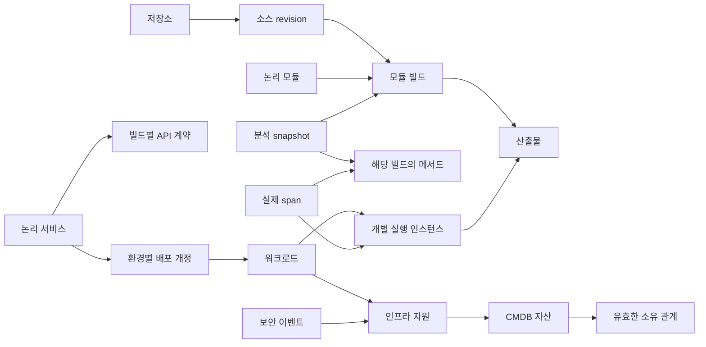

# 코드와 실행 및 자원 근거의 식별과 시간 모델

에이전트와 SRE는 느린 요청이 실행한 코드뿐 아니라 당시 배포·자원·소유권·보안 근거를 찾아야 한다. 이를 위해 **대상의 식별, 대상의 버전, 대상에 관한 관계 주장**을 구분한다. 같은 이름이나 커밋을 가진다는 이유로 근거를 합치지 않는다.

[#76](https://github.com/DDINGJOO/JJAM-TONG/issues/76)은 [#65](https://github.com/DDINGJOO/JJAM-TONG/issues/65)의 첫 하위 작업이다. 아래는 전체 영역의 논리 모델과 검증할 계약이다. [작은 실행 실험](../../experiments/evidence_model_lab/README.md)은 그중 식별·시간·관계 조회와 기존 분석의 메타데이터 연결을 다룬다. 현재 PostgreSQL의 `analysis`·`method`·`call` 테이블과 웹 조회 계약은 유지한다.

## 먼저 답할 질문

| 질문 | 필요한 구분 |
| --- | --- |
| 이 요청은 어떤 코드와 분석 결과에 연결되는가? | 실제 실행 식별, 정확한 빌드·산출물, 분석 실행·해시 |
| 같은 커밋인데 왜 결과가 다른가? | 빌드 조건·의존성·생성 입력·산출물과 분석 설정 |
| 롤링 배포 중 어떤 버전에서 문제가 발생했는가? | 논리 서비스, 배포 개정, 개별 실행 인스턴스 |
| 이 공통 모듈을 바꾸면 어떤 서비스가 영향을 받는가? | 모듈 의존성과 실제 산출물 구성. 경로명으로 서비스 추정 금지 |
| 당시 어떤 인프라와 자산을 사용했는가? | 당시 관계의 유효 시간과 조회 시점까지 확보한 근거 |
| 관련 보안 이벤트를 확인할 수 있는가? | 동일 대상·시점의 원본 참조와 현재 조회 권한. 인과관계와 시간적 연관 구분 |

## 대상과 버전을 구분한다

다음 표는 논리 계약이다. 모든 항목을 하나의 범용 테이블이나 한 DB에 저장한다는 뜻은 아니다.

| 대상 | 식별과 버전 기준 | 합치면 안 되는 것 |
| --- | --- | --- |
| Repository · SourceRevision | 공급원 범위 안의 저장소 식별과 해당 저장소의 불변 revision | 표시 URL 변경과 저장소 교체, 브랜치와 실제 빌드 revision |
| Module · ModuleBuild | 선언한 논리 모듈과 정확한 빌드 입력·산출물의 결합 | 디렉터리 경로와 모듈, 같은 커밋의 다른 빌드 |
| Artifact | 종류와 해시 알고리즘을 포함한 산출물 내용 식별 | JAR·컨테이너 이미지·파생 분석 입력, 변경 가능한 이미지 태그 |
| AnalysisSnapshot | 분석 실행 ID·결과 해시와 도구·스키마·설정·입력 버전 | 빌드 자체와 분석, 다른 설정의 재분석 |
| MethodVersion | 정확한 모듈 빌드와 언어별 메서드 식별 | 이름이 같은 overload, 이전·새 빌드의 같은 이름 |
| Service · APIVersion | 명시한 논리 서비스 ID와 프로토콜별 API 식별·해당 빌드의 계약 | 모듈과 서비스, 정적 API 관계와 개별 요청 |
| DeploymentRevision | 서비스·환경·공급원 배포 식별과 불변 배포 개정 | Kubernetes Deployment UID 하나와 여러 rollout 개정 |
| Workload · RuntimeInstance | 공급원 범위의 워크로드와 개별 컨테이너·프로세스의 실행 식별 | Pod 하나와 내부 여러 컨테이너·프로세스 |
| Resource | 공급원·계정·리전·클러스터 등 원본 범위와 native ID·필요한 생성 식별 | 다른 계정의 같은 이름, 재생성된 같은 이름 |
| Asset · Owner | CMDB·조직 디렉터리 원본의 식별과 개정·유효한 소유 관계 | 인프라 자원과 자산 레코드, 현재 담당자와 과거 담당자 |
| SecurityEvent · Span | 수집원 범위 안의 이벤트 ID 또는 trace/span 식별과 발생 시각 | 비슷한 메시지, 다른 추적 영역에서 우연히 같은 ID |

native ID는 원본 시스템이 부여한 식별자다. 원본 ID가 재사용될 수 있으면 생성 세대도 보존한다. 표시 이름·태그는 검색과 후보 발견에 쓰며 동일성의 확정 근거로 쓰지 않는다. 여러 공급원의 자원이 같다는 판단은 **별도 근거가 있는 동일성 주장**으로 기록하고 원본 식별자를 지우지 않는다.

Java 연결부는 기존 `repository`·`revision`·`build`·`module`·`artifactSha256` 다섯 필드를 그대로 검증한다. JVM descriptor는 Java 메서드의 언어별 상세 정보이며 다른 언어의 필수 형식으로 삼지 않는다. 현재 v1의 저장소 문자열과 모듈 문자열을 플랫폼 전체의 영구 ID로 승격하지 않는다.

## 관계의 대상과 의미를 제한한다

화살표는 관계를 정의할 위치다. 현재 모든 화살표를 수집한다는 의미는 아니다. 특히 `Span → Method`는 관측한 메서드와 빌드가 일치하는지 확인해야 하며, 이름만 주어지면 overload 해석의 한계를 반환한다.

| 관계 묶음 | 카디널리티와 제약 |
| --- | --- |
| 모듈·빌드·서비스 | 한 서비스가 여러 모듈을 사용하고 한 모듈이 여러 서비스에 포함될 수 있다. 모듈만으로 서비스를 생성하지 않는다 |
| 분석·빌드·메서드 | 분석은 지정한 정확한 빌드에 속한다. 정적 메서드 관계에는 분석기와 원본 snapshot을 남긴다 |
| 서비스·배포·실행 | 한 서비스의 여러 배포가 동시에 유효할 수 있다. 개별 실행 인스턴스의 주 산출물 연결과 추가 로드한 라이브러리는 별도 관계다 |
| 서비스·공유 자원 | 여러 서비스가 하나의 자원을 참조할 수 있다. 선언한 사용 관계와 실제 접근 관측은 구분한다 |
| 자원·자산·소유권·사건 | 원본 식별·시간·권한을 가진 관계로 연결한다. 자산 연결이나 시간적 연관을 장애 원인의 확정으로 바꾸지 않는다 |

관계마다 허용하는 시작·끝 대상과 단일/복수 값을 정한다. 단일 값 관계에 서로 다른 주장이 있으면 충돌을 반환한다. 여러 배포나 공유 자원을 표현하는 복수 값 관계를 충돌로 처리하지 않는다. 단일 값의 범위에는 필요한 환경·컨테이너 역할 등도 포함해야 한다.

## 관계 주장은 출처와 두 시간 축을 갖는다

관계 주장은 수집원이나 분석기가 특정 관계를 보고했다는 기록이다. `OBSERVED`도 해당 수집원의 관측을 뜻하며 신뢰할 수 있는 원본의 증명이나 인과관계 확정은 아니다.

| 정보 | 의미 |
| --- | --- |
| 주장 ID·계약 버전 | 같은 기록의 재전송과 다른 내용의 충돌을 구분한다 |
| 관계 종류·정확한 양 끝 참조 | 대상 종류를 검사하며 빌드·분석·메서드의 버전을 고정한다 |
| `STATIC_CANDIDATE` | 지정한 분석 조건에서 얻은 정적 후보 |
| `OBSERVED` | 실제 수집 기록이 있는 실행·자원 관계 |
| `DECLARED` | 카탈로그·설정·빌드 명세의 선언 |
| `INFERRED` | 규칙 등으로 추정한 관계. 원본 근거와 추론 조건을 추적해야 함 |
| 출처·원본 참조 | 어느 공급원의 어느 기록을 다시 확인할 것인가 |
| `validFrom`·`validTo` | 원본이 관계가 유효하다고 주장하는 시간 구간 |
| `knownAt` | 플랫폼이 이 주장을 알게 된 시각 |
| 정정·철회 참조 | 기존 주장을 덮어쓰지 않고 정정 이력을 연결 |

유효 구간은 시작을 포함하고 끝을 제외한다. 끝 시각이 없으면 조회는 마지막으로 확인한 주장을 반환하되, 그 관계가 현재까지 유효함을 보장하지 않는다. 수집 실패는 삭제나 관계 종료의 증거가 아니다. 시각 형식·순서·구간을 검사하고, 서로 다른 출처의 시계 오차가 미치는 영향은 실제 공급원 연결에서 검증한다.

예를 들어 10시에 발생한 관계를 10시 5분에 수집했다면, **10시의 상태를 10시 3분까지 확보한 근거로 조회한 결과**에는 그 관계가 없다. 같은 상태를 10시 6분까지 확보한 근거로 다시 조회하면 포함된다. 10시 7분에 정정이 도착해도 10시 6분까지의 근거 조회는 그대로 재현돼야 한다.

정정·철회는 원본 주장과 같은 조직·출처·대상·관계·근거 종류에 속해야 한다. 정적 후보를 관측 관계로 고치거나 다른 수집원의 주장을 지울 수 없다. 서로 다른 출처의 충돌은 모두 남기고 임의의 우선순위를 정하지 않는다.

조회 결과에서는 허용 범위의 주장만으로 상태·충돌·표시량을 계산한다. 이 실험은 수정 대상의 ID로 숨은 근거가 드러나지 않도록 모든 조회 결과에서 정정·철회 연결 ID를 일괄 생략한다. 원장에는 원본 연결을 보존하며, 이력 전용 조회의 인가는 별도로 설계해야 한다. 조회 결과의 주장은 원장 재입력용 원본이 아니다.

## 저장 경계의 대안

| 경계 | 현재 구현 또는 비교할 대안 | 확인할 부담 |
| --- | --- | --- |
| 불변 분석 원본 | 현재 PostgreSQL JSONB와 분석별 메서드·호출 테이블 | 기존 해시·동시 발행·이력 계약 보존 |
| 빌드·카탈로그·관계 이력 | 타입별 관계형 테이블 또는 타입을 검사하는 그래프 원본 | 무결성·시간 조회·보존·마이그레이션 |
| 다단계 그래프 조회 | 관계형 인덱스와 제한 탐색 또는 별도 그래프 조회 모델 | 정확한 원본 해시의 준비 여부·동기화 지연·재구축 |
| 대량 Trace·로그·메트릭·보안 기록 | 영역별 저장소의 원본 참조와 필요한 검색·집계 | 데이터량·현재 권한·보존·수집 유실·운영 비용 |

이번 선택은 [ADR 0012](../decisions/0012-evidence-identity-time-model.md)의 타입·시간 계약 실험이다. PostgreSQL·Neo4j·Elasticsearch·ClickHouse 중 전체 플랫폼의 원본을 다시 선정한 결과가 아니다. 기존 [단독·조합 비교](../experiments/STORAGE-TOPOLOGY-COMPARISON.md)와 [질문별 그래프 실측](../experiments/GRAPH-SCALE-COMPARISON.md)을 이후 실제 도메인 입력과 연결한다.

## 에이전트와 사람의 조회 흐름

에이전트는 대상·조직·현재 허용 범위, 조사할 시점, 어느 시점까지 확보한 근거를 사용할지, 필요한 근거 종류와 응답 상한을 지정한다. 응답은 원본 참조·정확한 버전·시간·누락 이유를 유지한다. 전체 그래프를 한꺼번에 전달하지 않는다.

화면에서는 선택한 Trace의 개별 span에서 빌드·분석·배포·자원으로 이동한다. API·빌드별 가능한 관계와 개별 Trace에서 관측한 흐름을 구분하고, 버전을 바꿀 때 일치 여부를 다시 검사한다. 다음은 구현 전에 확인할 QA 기준이다.

| 상태 | 사람이 확인할 표시와 동작 |
| --- | --- |
| 일치하는 근거 | 선택한 빌드·분석 해시와 두 시간 기준을 표시하고 원본으로 이동 |
| 알려진 범위에서 일치 없음 | 조회 조건과 수집 범위를 표시. 실제 관계가 없다고 단정하지 않음 |
| 부분·범위 제한 | 잘린 이유와 상한·제한 범위를 표시. 숨긴 대상의 ID·개수·충돌 내용은 노출하지 않음 |
| 서로 다른 주장 | 출처별 근거와 유효 시간을 나란히 표시하고 자동 확정하지 않음 |
| 빌드·해시 불일치 | 이동을 중단하고 불일치 필드를 설명. 최신 분석으로 대체하지 않음 |

이번 작업은 기존 화면의 탐색 흐름을 변경하지 않는다. 실제 화면의 정상·빈 결과·오류·복구·작은 화면 검증은 이 계약을 UI에 연결하는 후속 작업에서 수행한다.

## 검증과 남은 구현

[BDD-MDL-001~013](../../specs/features/13-evidence-model.feature)은 식별·다대다·시간·근거 종류·충돌·조회 범위·기존 분석 연결을 명세한다. 대응하는 작은 실행 실험의 판정과 기존 합성 PostgreSQL 분석의 읽기 검증은 [결과](../experiments/EVIDENCE-MODEL-RESULTS.md)에 기록한다. Gherkin 파일 자체를 실행하는 수락 테스트와 구분한다.

자동 빌드·모듈 발견과 변경 영향은 #65, HTTP·이벤트의 정적/관측 관계는 [#66](https://github.com/DDINGJOO/JJAM-TONG/issues/66)으로 이어간다. 배포·자산·보안 수집은 [#21](https://github.com/DDINGJOO/JJAM-TONG/issues/21)·[#25](https://github.com/DDINGJOO/JJAM-TONG/issues/25)·[#28](https://github.com/DDINGJOO/JJAM-TONG/issues/28)·[#31](https://github.com/DDINGJOO/JJAM-TONG/issues/31)의 전체 구현 범위에 포함된다. 영구 ID 발급·실제 공급원 정정 정책·인증·보존·저장소 이관·지속 수용량은 실제 연동과 함께 검증한다.
