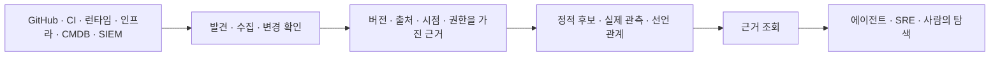

# 아키텍처와 설계 결정

[위키 홈](Home.md) · 원본: [구조 제안](../ARCHITECTURE.md), [설계 토론](../DISCUSSIONS.md)

## 토론할 책임과 데이터 흐름

아래는 책임을 논의하기 위한 개념도다. 배포 단위·제품 스택을 확정한 그림이 아니다.

논리 서비스·배포·실제 자원을 구분하고, 근거에 담을 정보와 의미를 정하는 공통 계약을 검토한다. 영역별 분석·수집 도구를 연결하는 구성 요소(adapter)의 책임도 논의한다. 에이전트 조회와 운영 변경 실행의 권한·정책은 따로 명세한다. 언어별 정적 해석 수준이나 공급원마다 다른 수집 의미를 공통 형식만으로 같다고 가정하지 않는다.

## 기록된 결정

| 결정 | 채택한 범위 | 아직 남은 선택 |
| --- | --- | --- |
| [ADR 0001: 관계 갱신의 검증 기본안](../decisions/0001-reconciliation-baseline.md) | 관계의 원본을 주기적으로 다시 확인하고, 변경 알림을 받으면 확인 시점을 앞당김. 두 경로는 같은 재확인 작업으로 연결 | 공급원별 연동 방식, 운영 주기와 보존 정책, 제품 언어·DB·메시지 중개 도구, 상시 실행 작업자 |

이 기본안은 현재 상태 복구에 관한 것이다. **놓친 중간 커밋·trace·보안 사건의 발생 이력이 자동 복원되지는 않는다.** 이력 수집·보존은 별도 계약으로 검증한다. 현재 실험의 인덱스는 파일·blob 관계이며 메서드 그래프 분석과 실제 build/trace 결합은 아직 없다.

## 폴링과 알림을 함께 비교하는 이유

| 방식 | 기대 이점 | 확인할 부담·실패 |
| --- | --- | --- |
| 주기 확인 | 알림을 못 받거나 놓쳐도 원본 현재 상태를 다시 확인 | 변경이 없어도 발생하는 조회 비용, 다음 확인까지의 반영 지연, 확인 사이에 놓친 중간 이력 |
| 변경 알림 | 변경을 빠르게 감지 | 중복·역순·누락·재전송·초기 상태 |
| 주기 확인 + 알림 | 빠른 감지와 현재 상태 복구를 조합 | 공통 재확인·작업 병합·재시도·호출 예산과 이력 보존 |

비교 근거는 [첫 실험](../experiments/RESULTS.md)과 [원본 재확인 실험](../experiments/HYBRID-RESULTS.md)에 있다. Kubernetes list/watch 등 실제 공급원의 동작은 별도 검증 대상이다.

## 다음에 결정할 질문

근거 중앙 보관과 연합 조회, 정적 분석기·런타임 계측, 버전 식별과 보존, 조회 API·CLI·MCP, 배포 환경·이식성, 카탈로그 충돌 처리, 권한과 운영 실행 정책이 열려 있다. 대안·예상 이점·부담·판별 실험은 [D01~D10 설계 토론 원본](../DISCUSSIONS.md)에서 관리한다.

결정할 때는 문제·근거·대안·선택 또는 보류·영향·검증·연결 이슈를 ADR로 남긴다. 기존 결정을 바꾸면 이전 기록과 변경 이유를 보존한다. 위키를 수정했다는 이유로 제품 기술을 채택하지 않는다.
